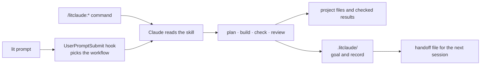

<p align="center"><picture><source media="(prefers-reduced-motion: reduce)" srcset="./docs/assets/cover-motion-still.webp" /></picture></p>

<h1 align="center">LitClaude</h1>
<p align="center"><strong>Keep the work lit.</strong></p>
<p align="center">A Claude Code plugin that helps every session plan the work, build it, check it, and leave a note the next session can pick up.</p>

<p align="center">
<a href="https://www.npmjs.com/package/@litfamily/litclaude"></a>
<a href="https://www.npmjs.com/package/@litfamily/litclaude"></a>
<a href="./LICENSE"></a>
<a href="https://github.com/wjgoarxiv/litclaude/stargazers"></a>
</p>

Add `lit` to a Claude Code prompt and Claude pins the goal, writes a failing test first, checks
the real result and writes down what it found. Type `handoff` when you stop, and the next session
starts from that note instead of from scratch. To try it, install once and give Claude a task:

```bash
npx @litfamily/litclaude@latest install   # then open a new Claude Code session
```

```text
lit fix the date parsing bug in src/dates.js, with a test
```

<p align="center"><a href="#install">Install</a> &nbsp; <a href="#quick-start">Quick start</a> &nbsp; <a href="#what-you-can-make">Showcase</a> &nbsp; <a href="./docs/guide.md"> Guide</a> &nbsp; <a href="./docs/skills.md">Skills</a> &nbsp; <a href="./docs/assets/readme/ignition-film.mp4"> Film</a> &nbsp; <a href="./docs/guide.md#safety"> Safety</a> &nbsp; <a href="./README_ko-KR.md">한국어</a></p>

<!-- demo-gif --><p align="center"></p>

## What you can make

Every picture below is a real output of LitClaude. Where a prompt sits under a picture, that request produced it in a Claude Code session (long ones are cut short with …); where none does, the skill's own engine made it from the example the skill ships with. None of them is a mock-up, so typing the same line with LitClaude installed gets you the same kind of result. The skills that make things aim for a full, dense result by default; say calm or minimal and they hold back.

### Draw it

Equipment, systems and data, each drawn by the skill that knows its rules: ISA-5.1 tags and a title block on a P&ID, material colours on a cutaway, numbered flows on an architecture, error bands on a figure.

<table>
<tr><td width="50%" valign="top"><br /><b>lit-schematic</b> · P&amp;ID on one A3 sheet<br /><code>lit draw a detailed P&amp;ID of a distillation column overhead section on one A3 sheet: shell-and-tube overhead condenser, reflux drum, duty and standby reflux pumps, LIC to FIC cascade …</code></td><td width="50%" valign="top"><br /><b>lit-schematic</b> · isometric cutaway<br /><code>lit-schematic 교반식 재킷 회분 반응기(jacketed stirred batch reactor)의 등각 단면 사시도를 그려줘</code></td></tr>
<tr><td width="50%" valign="top"><br /><b>lit-diagram-drawer</b> · system architecture<br /><code>lit-diagram-drawer 음식 배달 플랫폼의 시스템 아키텍처 다이어그램을 그려줘</code></td><td width="50%" valign="top"><br /><b>lit-scientific-visualization</b> · two-panel journal figure<br /><code>/litclaude:lit-scientific-visualization 현재 폴더의 data.csv(세 온도에서 측정한 CO2 흡착 등온선, 반복 2회)를 논문용 그림으로 만들어줘</code></td></tr>
<tr><td width="50%" valign="top"><br /><b>lit-schematic</b> · apparatus figure<br /><code>lit 레이저 광학 벤치 실험 장치를 저널 double column 그림 한 장으로 그려줘 …</code></td><td width="50%" valign="top"><br /><b>lit-schematic</b> · cutaway as a loop<br /><code>lit … 오토클레이브 컷어웨이를 짧은 루프 모션 영상으로 만들어줘: 분해된 부품이 조립되고, 임펠러가 돌고, 냉각수가 코일을 따라 흐르게</code></td></tr>
</table>

### Present it

Name a style, or let lit-pptx choose one from thirteen. Every deck has native, editable charts and KPI rows, Pretendard embedded, and passed a gate for overflow, contrast and empty slides.

<table>
<tr><td width="50%" valign="top"><br /><b>lit-pptx</b> · newsroom, 10 slides<br /><code>lit 우리 구 주민에게 보여줄 2026년 대중교통 이용 데이터 브리핑 발표자료 10장, 뉴스룸 스타일로</code></td><td width="50%" valign="top"><br /><b>lit-pptx</b> · neo-brutalism pitch<br /><code>lit 신규 서비스 투자 피칭 덱 10장, 네오 브루탈리즘 스타일로. 글자와 숫자는 크고 굵게</code></td></tr>
<tr><td width="50%" valign="top"><br /><b>lit-pptx</b> · one deck, 13 tonalities<br /><sub>The same sample deck rendered by the engine in all thirteen tonalities, from paper and newsroom to riso, night and ledger.</sub></td></tr>
</table>

### Write it

lit-docx writes a Word file you can keep editing: a cover, key figures with their basis, tables with right-aligned numbers and a decision box, then renders the pages and looks at them before it hands the file over.

<table>
<tr><td width="50%" valign="top"><br /><b>lit-docx</b> · Korean report, Report tonality<br /><sub>Built from the skill's bundled example <code>references/examples/01-report-ko.md</code> by its own converter; the layout gate passed.</sub></td><td width="50%" valign="top"><br /><b>lit-docx</b> · English report and a proposal<br /><sub>Two more bundled examples: <code>07-report-en.md</code> (Report) and <code>04-proposal-ko.md</code> (Proposal).</sub></td></tr>
</table>

### Build it

frontend-ui-ux locks a house style before it writes markup, builds the page, then opens it at several widths and reviews its own screenshots. readme-studio does the same for a project cover.

<table>
<tr><td width="50%" valign="top"><br /><b>frontend-ui-ux</b> · operations dashboard<br /><code>Build the operations dashboard for Coldline, a regional delivery company that runs a fleet of refrigerated trucks. …</code></td><td width="50%" valign="top"><br /><b>frontend-ui-ux</b> · landing page, neo-brutalism<br /><code>Build the marketing landing page for Ledgerline … Make it neo-brutalism: loud, friendly, bold outlines and hard shadows.</code></td></tr>
<tr><td width="50%" valign="top"><br /><b>frontend-ui-ux</b> · landing page, computational brutalism<br /><code>Build the marketing landing page for Ledgerline … Make it retro-futurist computational brutalism: raw, mechanical, like an instrument or a spec sheet.</code></td><td width="50%" valign="top"><br /><b>readme-studio</b> · README cover<br /><sub>The skill's HyperFrames cover template with every letter outlined by its own type tool, for a sample project.</sub></td></tr>
</table>

### Film it

lit-typographic-motion writes a treatment first, then renders the film frame by frame with a sound bed and checks flashes, legibility and the loop seam. The prompt below names no tool and never asks for a dense look; the layering, colour and sound came from the defaults.

<table>
<tr><td width="50%" valign="top"><br /><b>lit-typographic-motion</b> · 13-second hero film, poster<br /><code>lit LitClaude 히어로 영상 13초짜리 만들어줘. LIT 불꽃 키가 주인공으로, 프롬프트 → 계획 → 작업 → 리뷰 → 완료로 lit-loop가 돌아가는 세계를 고퀄리티 3D로 보여줘.</code></td><td width="50%" valign="top"><br /><b>lit-typographic-motion</b> · frames from the same film<br /><sub>Twelve frames of that film, from the dark opening to the LitClaude title.</sub></td></tr>
</table>

### Keep track of it

When two workflows and three helpers run at once, the LIT card draws them as threads under the prompt. Type <code>lit adhd</code> after a scattered day and you get one brief: what you asked, what got done, what is paused and the next step. <code>go</code> then picks up the single open plan.

<table>
<tr><td width="50%" valign="top"><br /><b>LIT card</b> · thread rows<br /><sub>Drawn by the card's own renderer: lit-loop paused at GREEN, start-work running under it, three lanes in parallel.</sub></td><td width="50%" valign="top"><br /><b>lit-adhd</b> · the brief<br /><code>lit adhd</code></td></tr>
<tr><td width="50%" valign="top"><br /><b>lit-adhd</b> · go resumes the plan<br /><code>go</code></td></tr>
</table>

### Learn from others

Point <code>lit hijack</code> at an article, a post, a PDF or a repository and name your own skill. It records where each source came from and what its licence allows, writes a spec in its own words, has it built in isolation, runs the old and new skill on the same held-out prompt, and ends with a port report.

<table>
<tr><td width="50%" valign="top"><br /><b>lit-hijack</b> · port report<br /><code>lit hijack https://x.com/… into .claude/skills/promo-brief</code></td><td width="50%" valign="top"><br /><b>lit-hijack</b> · old skill against new<br /><sub>The proof: two runs of the old skill beside two of the new one on the same prompt. The old briefs invent product features; the new ones ask instead.</sub></td></tr>
</table>

## Why LitClaude

You ask Claude Code for something: a bug fixed, a screen built, a project finished. Starting
takes one sentence. The trouble comes later. The conversation grows, the context gets
compacted, the session ends, and next time you have to work out where you left off: what you
decided, what you checked, what comes next. And "done" often means the model said so.

LitClaude gives each session a routine to follow. Add `lit` to a request and Claude pins the
goal, writes a failing test first, checks the real thing it built, and records what it found.
For a bigger change, `lit plan` writes a plan you approve before anything is edited. When you
stop, a handoff file keeps the goal, the results and the next step in your project, where the
next session can read them. Claude Code still runs the session and picks the model, and
LitClaude adds the way of working on top.

In one line, for a friend: *put `lit` in front of a Claude Code task and it writes the failing
test first, checks the result, and leaves tomorrow's session a note.*

### Who it's for

LitClaude suits people who already use Claude Code on real projects and want two things from
it: proof before "done", and a session that can pick up where the last one stopped. It helps
most on work that runs longer than one sitting, such as a feature with tests, a refactor or a
research question. It also builds slides and Word reports and cleans up stiff Korean or English
prose, so it is useful outside code as well.

### What a session looks like

This is the demo above in three lines. You type the first one, LitClaude's prompt hook answers
with the second, and the card above the prompt walks the third as the work happens:

```text
lit add a --shout flag that prints the greeting in capitals, with a test
LIT IGNITED · lit-loop
PIN → RED (the new test fails) → GREEN (the tests pass) → VERIFY
```

## Install

You need Node.js with npm, and Claude Code. Run this in any terminal:

```bash
npx @litfamily/litclaude@latest install
```

The first time, npx asks whether to install the package; answer `y`. The installer registers
the plugin, adds the LitClaude status line, and asks you two things: the status-line colour and
an optional output style. A new install starts in the `safe` permission mode, which adds no
permission rules, and leaves the rest of your Claude settings as they are. It also downloads
the rendering engine and fonts the video skill needs, so the first install takes a little
longer. Quit Claude Code and start it again afterwards so the plugin loads.

Two switches change how the install runs:

- `--yes` after `install` keeps the default colour and style, for when you would rather not
  answer questions.
- `--dry-run` before `install` prints every change and makes none, for when you want to look
  first: `npx @litfamily/litclaude@latest --dry-run install`.

[Permission modes, version pins, global installs and every other switch](./docs/guide.md#installation-reference).

If you only want the plugin, without the status line or the installer, Claude Code can add it
from the LitFamily marketplace:

```text
/plugin marketplace add wjgoarxiv/litfamily
/plugin install litclaude@litfamily
```

Pick one of the two routes. Enabling the plugin both ways loads its hooks twice.
[Choosing between the npm and marketplace routes](./docs/migration.md#scoped-npm-migration).

You can also hand the install to a coding agent. Paste this prompt into it; the agent checks
your setup, shows you what would change and waits for your yes before it installs anything:

```text
Please install LitClaude, a plugin for Claude Code, on this computer.

- Use only the official npm package @litfamily/litclaude. Do not clone repositories or
  install anything else.
- Before you change anything, check that Node.js, npm and Claude Code are installed, then run
  npx @litfamily/litclaude@latest --dry-run install --yes
  Show me what it would change and ask whether to go ahead. Wait for my answer.
- When I say yes, run npx @litfamily/litclaude@latest install --yes
  (--yes keeps the default status-line colour and output style; I can run the install again
  in my own terminal later to pick them.)
- Then run npx @litfamily/litclaude@latest doctor and tell me the result. It should end in
  DOCTOR_PASS. If it does not, show me the lines that failed and stop there.
- Finally, remind me to quit Claude Code and start it again so the plugin loads.
```

## Quick start

Start Claude Code in a project folder the usual way, then type `lit`:

```bash
claude
```

```text
lit
```

You will see the activation notice from the picture above. Now hand it one small task:

```text
Build a to-do list in a single HTML file with no external dependencies.
Implement add, complete, and delete. Record what you checked and the next step.
```

Claude's reply opens with **🔥 LIT IGNITED · lit-loop 🔥**, works through the goal and its
checks, and ends with what it checked and what comes next. Then open the HTML yourself and
click through all three actions; that is the only way to know the buttons work. If Claude
had no browser to test with, ask it to mark the look and the clicks as unverified.
[Pictures of the installer, doctor and status line](./docs/guide.md#what-you-will-see-on-screen).

When you stop for the day, type `handoff` and keep the file path it gives you. In the next
session, open the same project and ask Claude to read that file, check the current state and
name the next step.

## The LIT card

While you work, LitClaude keeps a small card just above the prompt. It shows where you are in
the LIT workflow, what Claude is doing at this moment and which skills it has used, so you can
follow Claude without scrolling back through the conversation.

Read it from top to bottom:

- The top edge names the workflow and its stage.
- The first row is a map of that workflow. A request runs from the interview through the plan,
  the work and the review to done, a research run goes wave by wave, and a lit-loop criterion
  steps from PIN through RED and GREEN to RECORD. Stages behind you carry a check and the one
  you are in is lit. A request that fits none of these keeps the simpler PLAN, WORK and REVIEW
  track.
- The second row says more about that stage: the task count and the next task, the review
  lanes that have passed, or the interview round. On its right sits the tool Claude is running
  and for how long. Only the tool's name appears there; what the tool was given stays out.
- The third row holds a chip for each LitFamily skill that fired.
- The bottom edge repeats the context, the five-hour and weekly usage and the Git branch from
  the status line.

Before anything runs, the card rests and tells you how to begin:

<p align="center"></p>

Give it a request with `lit`, and the card names the workflow, lights the stage it is in and a
chip for the skill that took the request. LitClaude's own hooks move the map on as the work
happens, when the plan is saved, a task is ticked or a reviewer reports, so it keeps up without
Claude having to report each step:

<p align="center"></p>

While Claude is busy, the card does not sit still. The LIT pill slowly glows from pink to
orange and back, a light passes over the stage it is in and over the skill chip, a bright point
travels along the map toward the next stage, and a spark runs along the top edge and back along
the bottom. A glance is enough to tell that LitClaude is still at work.

Real work rarely runs one thing at a time. Say a lit-loop is halfway through when you type
`/litclaude:start-work`, Claude sends three subagents out in parallel, and a dev server keeps
running in the background. The card then gives each of them a row under the map, nested the
way they belong together. The loop you interrupted stays on the card as paused, with its stage
and count kept, and the start-work run that took over hangs under it. Parallel subagents and
background tasks branch off a fork line, each with a small gauge of its own progress (a short
moving pulse while its total is still unknown), and past four rows the last one says how many more there are. When the start-work run is done,
`lit continue` brings the loop back at the count where it stopped:

<p align="center"> start-work with GREEN || on the right, the map shows PIN and RED checked and GREEN 2/5 paused, the detail row reads start-work · back: lit continue with ●●● 3 lanes and Bash · 0:04 on the right. Below it the row lit-loop GREEN [▉▉░░░] 2/5 paused, and under it └─ ● start-work work [▉▉▉░░░] 3/6 running. A fork line ┬ 3 lanes · 1 task in parallel leads to executor [▉▉░░] 2/4 running, librarian-researcher [▉░] 1/2 running and lit-verifier running behind a short pulse line because its total is not known yet, with +1 more on the right. The skills row holds start-work, lit-loop and lit-plan, and the bottom edge shows ctx 24%, 5h 22%, 1w 54% and the branch main." /></p>

When the turn ends, the card goes back to idle and stops moving. The map keeps where the work got to,
and the chip turns grey and stays as a recent skill, so you can still see what ran last:

<p align="center"></p>

The card needs Claude Code 2.1.287 or later, in the terminal or in the Code tab of the Claude
desktop app. The installer sets up both, since the app reads the same settings; open a new
session in the app after installing. The app draws the card as a picture with the same rows and
motion, because it sets mod text in a proportional font.

By default the card stays for the whole session and moves while Claude works. Three options in
`/config`, under LitClaude, change that:

- `band` set to `auto` shows the card only while work runs, if you like a clean prompt between
  tasks; `off` hides it.
- `motion` set to `subtle` gives a quieter card, and `off` keeps it still.
- `notify` set to `finish` is for when you step away during long work. LitClaude then sends a
  notification through your terminal when the work completes or a LIT turn longer than three
  minutes ends. It stays off until you turn it on.

The desktop app has no editor for these options, so change them from a terminal there:

```bash
npx @litfamily/litclaude@latest config             # show the options
npx @litfamily/litclaude@latest config band auto   # or motion subtle, glyphs basic, notify finish
```

[Everything the card can show](./docs/hooks.md#the-lit-band-claude-code-mod).

## Automatic handoff

A long session fills Claude's context window, and when Claude Code compacts it, details of your
work can drop out of the summary. Automatic handoff has Claude write a handoff file while there
is still room, then reads it back after the compaction, so the rest of the session picks up from
your own notes.

It stays off until you turn it on and choose the percent. Type `lit-handoff auto on 65` as your
whole prompt, with any whole number from 1 to 99, and LitClaude answers with a single line
without starting any other work. Later, `status` tells you
what is in force, and `off` turns it off while keeping your percent for next time:

<p align="center"><picture><source media="(prefers-color-scheme: dark)" srcset="./docs/assets/handoff/settings-dark.webp" /></picture></p>

The setting belongs to the project folder you start Claude Code in, so each project keeps its
own. Choose a percent below the point where Claude Code compacts by itself; if the compaction
comes first, there is no handoff to bring back. While it is on, the status line shows
`handoff@65%`.

When a turn ends with the context at or past your percent, the Stop hook asks Claude to write
the handoff before it stops. Claude Code gives a plugin no way to start a compaction, so
Claude ends with a one-line reminder and you run `/compact`. When the compaction is done,
LitClaude reads the fresh handoff back into the conversation:

<p align="center"><picture><source media="(prefers-color-scheme: dark)" srcset="./docs/assets/handoff/compact-dark.webp" /></picture></p>

You can also switch it on from the shell before you start Claude Code. The two variables win
over the saved setting, and the doctor shows what is in force:

<p align="center"><picture><source media="(prefers-color-scheme: dark)" srcset="./docs/assets/handoff/env-dark.webp" /></picture></p>

[How automatic handoff works, step by step](./docs/guide.md#automatic-handoff).

## What you get

LitClaude ships 39 skills you can start, three that run on their own, 20 slash commands and
11 agents. Most days you will use a handful of them.

### The work loop

Add `lit` to any request. Claude pins the goal, writes a failing test first, makes the
smallest change that passes it, checks the real result, and leaves a record in the project.

```text
Fix the date parsing bug in src/dates.js and add a test that fails without the fix. lit
```

### Plan first, then build

For a larger change, `lit plan` writes a plan with numbered tasks and a yes-or-no check for
each one, and edits nothing yet. Read it, and when it looks right, type `/litclaude:start-work`
with the plan file. Typing the command is the approval, so there is no goal line to paste first.
It runs the plan task by task and ticks a box only after its checks pass. With a single open
plan, the command alone is enough.

```text
lit plan Add CSV export to the reports page, with tests.
/litclaude:start-work <the plan file it wrote>
```

### A second look before you merge

`lit review` picks a mode from what exists: plan review for a plan that has not started, work
review for a finished change. Work review sends five independent review lanes over the same
change and its evidence. They report findings first; fixing them is a separate step. `lit review
plan` or `lit review work` forces a mode.

```text
lit review the changes on this branch
```

### Research with sources

`lit research` splits a question, sends parallel searchers over public sources, and keeps
facts and uncertainty apart in the answer. It stops at logins and paywalls.

```text
lit research Which SQLite settings matter most for write speed in a small web app?
```

### Slides, reports and Korean prose

Ask for slides or a report and end the prompt with `lit`: you get an editable `.pptx` deck
with native charts or a styled `.docx` document, set in Pretendard and checked page by page
as rendered. `lit-humanizer` rewrites stiff English or Korean prose and keeps the facts.

The skills that make things aim for a full result by default: decks, diagrams, schematics,
figures, interfaces and films come out dense and dressed, with several accent colours and a
signature detail. If you want something quieter, say so (calm, minimal, quiet) and they hold
back.

```text
팀 워크숍 발표자료 만들어줘 lit
write a two-page project proposal for the new onboarding flow lit
lit-humanizer docs/intro.md
```

### P&IDs, apparatus figures and cutaways

`lit-schematic` draws real equipment: a P&ID with ISA-5.1 tags, routed lines, a legend and a
title block, a two-panel journal figure of an experimental setup, or an isometric cutaway of a
vessel. Each drawing passes a QA gate for overlaps, lines through symbols and small text, and is
exported as SVG, PDF and a 600 dpi PNG that Claude opens before it reports.

```text
lit draw a P&ID of the high-pressure hydrate reactor loop
lit 논문용 실험 장치 모식도 그려줘
```

### Bring in a technique you read about

You read a thread, an article or a repository that does something your own skill does not, and
you want that know-how without copying their text. `lit hijack` takes the sources and the
target, records where each one came from, checks its licence and drops what may not be used,
and finds what your skill lacks, with file and line evidence. It then writes a spec in its own
words, has it built through `lit plan` and start-work, and proves the change by running the
same prompt against the old and the new version. The report says what was taken, what was left
and why.

```text
lit hijack https://x.com/… and docs/paper.pdf into my lit-pptx skill
```

### Carry work into the next session

`handoff` writes a continuation file with the goal, what was checked and what is left.
Automatic handoff can write it for you before Claude Code compacts a long session; it stays
off until you pick a percent with `lit-handoff auto on 60`.

### Where was I?

After a day of several windows, worktrees and interruptions, `lit adhd` (or its alias `lit
rewind`) reads every recent Claude Code session of this repository and gives you one screen:
what each session was asked, what it did and whether it waits on you, how far the roadmap and
each open plan have come, with progress gauges, the work that is paused, and one next step. It
changes nothing. If that step is what you want, type `go` in the same session within half an
hour, and Claude takes it.

```text
lit adhd
go
```

[All routes](./docs/guide.md#what-to-type) and [all skills, with a picture of each](./docs/skills.md).

## How it works



The installer copies the plugin into Claude Code's plugin folder and registers it. When you
send a plain prompt, a hook reads it and adds a short note telling Claude which workflow fits;
a slash command goes straight to its skill. Other hooks load your project rules at session
start and remind Claude what to check after an edit. Goal-bound work keeps its record in the
project's `.litclaude/` folder, which carries its own `.gitignore` (containing `*`), so Git
skips it without any change to your own ignore files. Nothing runs between sessions.
[The hooks in detail](./docs/hooks.md) and [what goes over the network](./docs/privacy.md).

## Requirements, update and uninstall

You need Node.js with npm, and Claude Code. Slides and documents install their pinned tools
into `~/.cache/litclaude/office-runtime` the first time you use them.

Three commands look after an npm install:

```bash
npx @litfamily/litclaude@latest doctor      # check the plugin, status line and permission mode
npx @litfamily/litclaude@latest update      # install the latest release now
npx @litfamily/litclaude@latest uninstall   # remove what LitClaude installed
```

A healthy `doctor` run ends in `DOCTOR_PASS`. You rarely need `update` by hand: once a day at
most, a new Claude Code session checks npm for a newer version in the background, and a later
session installs it before it starts work. `uninstall` removes only the plugin, status
line, permission and local state entries LitClaude manages. If an install was changed by hand,
it leaves it alone and points you to the
[ownership guidance](./docs/migration.md#ownership-conflicts).

If you added the plugin through the marketplace, it has no LitClaude status line, and you
update or remove it from Claude Code's `/plugin` menu.

## Learn more

- [Guide](./docs/guide.md): install options, what you will see on screen, the promo film,
  every route, automatic handoff, slides and documents, the status line, safety, and the
  Claude Code integration in depth.
- [All skills](./docs/skills.md): the 39 skills and the automatic checks, one row each.
- [Hooks](./docs/hooks.md), [agents](./docs/agents.md), [privacy and network behavior](./docs/privacy.md),
  [migration and ownership conflicts](./docs/migration.md),
  [package-name migration and marketplace choices](./docs/migration.md#scoped-npm-migration), [native `/goal` surface](./docs/native-goal-surface.md)
  and the [workflow compatibility audit](./docs/workflow-compatibility-audit.md).
- [Development](./docs/development.md): checkout gates, local plugin loading and the project map.
- [Release history](./CHANGELOG.md) and the [Korean README](./README_ko-KR.md).
- [LitFamily](https://github.com/wjgoarxiv/litfamily): the same way of working for other coding agents.

## LITFAMILY

The seven armored robots on the cover stand for the seven LitFamily products. Each one runs on
its own in its own host, so install just the one you use. The cover is brand motion, and the
[Ignition film](./docs/assets/readme/ignition-film.mp4) is a short brand film in the same
spirit. The demo near the top of this page is the one that shows a real Claude Code session.

<p align="center"></p>

<details>
<summary>Copy ASCII logo</summary>

```text
                             ▄▄▄▄
                   ▗███▌   ▗██████▖
 ▗▄▄▄▄▄          ▗▟████▌   ▝██████▘
 ▐█████        ▗▟██████▌    ▝▀▜█▀▘
 ▐█████      ▗▟███████▄▄▄▄▄▄▄▄▄▄▄▄▄▄▄▄▄▄▄▄
 ▐█████    ▗▟█████████████████████████ ▐█▀
 ▐█████    ████████████████████████████▀
 ▐█████    ██▛▘   ▄ ▄▄▄▄▖▄▄▄▄▄▄▄▄▄▄▄▄▄▖
 ▐█████    ▀    ▄██ ████▌█████████████▌
 ▐█████       ▄████ ████▌█████████████▌
 ▐█████     ▄█████▛                                 claude
 ▐█████  ▗▟█████▀▘       ▄▄▄▄▄     ▗▖               ──────────────
 ▐█████ ▐█████▀          █████     ▐▛▀              hermes · codex
 ▐█████ ▐███▀            █████                      opencode · grok
 ▐█████ ▐█▀              █████                      muse · gravity
 ▐█████ ▝                █████
 ▐█████▄▄▄▄▄▄▄▖          █████
 ▐███████████▛           █████
 ▐██████████▀            █████

```

</details>

If LitClaude saves you from explaining the same project twice, a star on GitHub helps other
Claude Code users find it.

To contribute, start with the [contributing guide](./CONTRIBUTING.md); questions go to
[support](./SUPPORT.md), security reports follow [security](./SECURITY.md), and the
[code of conduct](./CODE_OF_CONDUCT.md) applies to everyone. LitClaude is released under the
[MIT license](./LICENSE).
