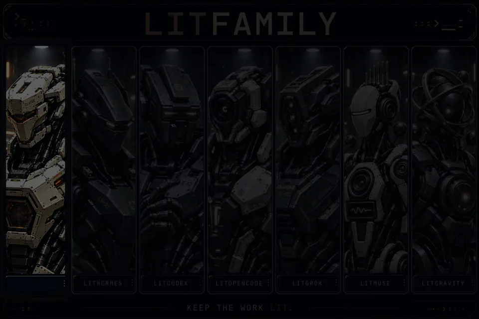
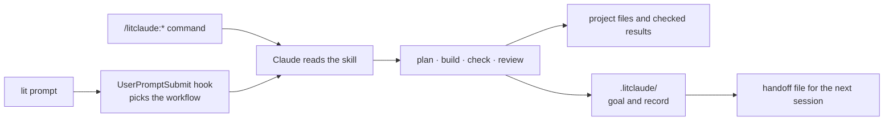
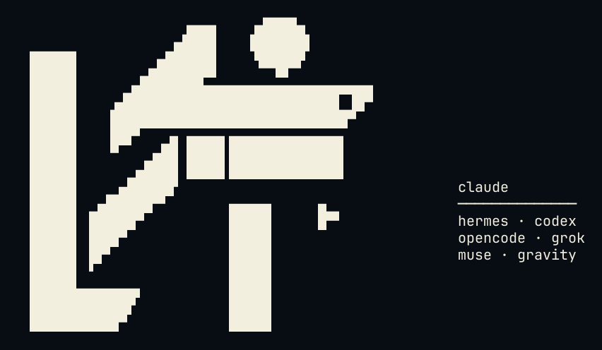

<p align="center"><picture><source media="(prefers-reduced-motion: reduce)" srcset="./docs/assets/cover-motion-still.webp" /></picture></p>

<h1 align="center">LitClaude</h1>
<p align="center"><strong>Keep the work lit.</strong></p>
<p align="center">A Claude Code plugin that helps every session plan the work, build it, check it, and leave a note the next session can pick up.</p>

<p align="center">
<a href="https://www.npmjs.com/package/@litfamily/litclaude"></a>
<a href="https://www.npmjs.com/package/@litfamily/litclaude"></a>
<a href="./LICENSE"></a>
<a href="https://github.com/wjgoarxiv/litclaude/stargazers"></a>
</p>

<p align="center"><a href="#install">Install</a> &nbsp; <a href="#quick-start">Quick start</a> &nbsp; <a href="./docs/guide.md"> Guide</a> &nbsp; <a href="./docs/skills.md">Skills</a> &nbsp; <a href="./docs/assets/readme/ignition-film.mp4"> Film</a> &nbsp; <a href="./docs/guide.md#safety"> Safety</a> &nbsp; <a href="./README_ko-KR.md">한국어</a></p>

<!-- demo-gif --><p align="center"></p>

<p align="center"><sub>A real Claude Code session with LitClaude installed, recorded in a terminal and replayed on a drawn terminal window with camera moves. Waiting time is shortened, the project folder is shown as ~/greet and a long temporary file path is blurred; the rest is as Claude Code printed it.</sub></p>

## Why LitClaude

You ask Claude Code for something: a bug fixed, a screen built, a project finished. Starting
takes one sentence. The trouble comes later. The conversation grows, the context gets
compacted, the session ends, and next time you have to work out where you left off: what you
decided, what you checked, what comes next. And "done" often means the model said so.

LitClaude gives each session a routine to follow. Add `lit` to a request and Claude pins the
goal, writes a failing test first, checks the real thing it built, and records what it found.
For a bigger change, `lit plan` writes a plan you approve before anything is edited. When you
stop, a handoff file keeps the goal, the results and the next step in your project, where the
next session can read them. Claude Code still runs the session and picks the model; LitClaude adds the way of
working.

## Install

You need Node.js with npm, and Claude Code. Run this in any terminal:

```bash
npx @litfamily/litclaude@latest install
```

The first time, npx asks whether to install the package; answer `y`. The installer then
registers the plugin, adds the LitClaude status line, and asks two questions: the status-line
colour and an optional output style. Add `--yes` after `install` to keep the defaults. To see
every change without making it, put `--dry-run` before `install`:
`npx @litfamily/litclaude@latest --dry-run install`. A new install uses the `safe`
permission mode, which adds no permission rules, and the rest of your Claude settings stay as
they are. It also downloads the rendering engine and fonts the video skill needs, so a first
install takes a little longer.
[Permission modes, version pins, global installs and every switch](./docs/guide.md#installation-reference).

If you only want the plugin, without the status line or the installer, Claude Code can add it
from the LitFamily marketplace:

```text
/plugin marketplace add wjgoarxiv/litfamily
/plugin install litclaude@litfamily
```

Pick one of the two routes. Enabling the plugin both ways loads its hooks twice.
[Choosing between the npm and marketplace routes](./docs/migration.md#scoped-npm-migration).

## Quick start

Start Claude Code in a project folder the usual way, then type `lit`:

```bash
claude
```

```text
lit
```

You will see the activation notice from the picture above. Now hand it one small task:

```text
Build a to-do list in a single HTML file with no external dependencies.
Implement add, complete, and delete. Record what you checked and the next step.
```

Claude's reply opens with **🔥 LIT IGNITED · lit-loop 🔥**, works through the goal and its
checks, and ends with what it checked and what comes next. Then open the HTML yourself and
click through all three actions; that is the only way to know the buttons work. If Claude
had no browser to test with, ask it to mark the look and the clicks as unverified.
[Pictures of the installer, doctor and status line](./docs/guide.md#what-you-will-see-on-screen).

When you stop for the day, type `handoff` and keep the file path it gives you. In the next
session, open the same project and ask Claude to read that file, check the current state and
name the next step.

## What you get

LitClaude ships 35 skills you can start, three that run on their own, 16 slash commands and
11 agents. Most days you will use a handful of them.

### The work loop

Add `lit` to any request. Claude pins the goal, writes a failing test first, makes the
smallest change that passes it, checks the real result, and leaves a record in the project.

```text
Fix the date parsing bug in src/dates.js and add a test that fails without the fix. lit
```

### Plan first, then build

For a larger change, `lit plan` writes a plan with numbered tasks and a yes-or-no check for
each one, and edits nothing yet. Once you approve it, `/litclaude:start-work` runs it task by
task and ticks a box only after its checks pass.

```text
lit plan Add CSV export to the reports page, with tests.
/litclaude:start-work <the plan file it wrote>
```

### A second look before you merge

`lit review` sends five independent review lanes over the same change and its evidence. They
report findings first; fixing them is a separate step.

```text
lit review the changes on this branch
```

### Research with sources

`lit research` splits a question, sends parallel searchers over public sources, and keeps
facts and uncertainty apart in the answer. It stops at logins and paywalls.

```text
lit research Which SQLite settings matter most for write speed in a small web app?
```

### Slides, reports and Korean prose

Ask for slides or a report and end the prompt with `lit`: you get an editable `.pptx` deck
with native charts or a styled `.docx` document, set in Pretendard and checked page by page
as rendered. `lit-humanizer` rewrites stiff English or Korean prose and keeps the facts.

```text
팀 워크숍 발표자료 만들어줘 lit
write a two-page project proposal for the new onboarding flow lit
lit-humanizer docs/intro.md
```

### Carry work into the next session

`handoff` writes a continuation file with the goal, what was checked and what is left.
Automatic handoff can write it for you before Claude Code compacts a long session; it stays
off until you pick a percent with `lit-handoff auto on 60`.

[All routes](./docs/guide.md#what-to-type) and [all skills, with a picture of each](./docs/skills.md).

## How it works



The installer copies the plugin into Claude Code's plugin folder and registers it. When you
send a plain prompt, a hook reads it and adds a short note telling Claude which workflow fits;
a slash command goes straight to its skill. Other hooks load your project rules at session
start and remind Claude what to check after an edit. Goal-bound work keeps its record in the
project's `.litclaude/` folder, which carries its own `.gitignore` (containing `*`), so Git
skips it without any change to your own ignore files. Nothing runs between sessions.
[The hooks in detail](./docs/hooks.md) and [what goes over the network](./docs/privacy.md).

## Requirements, update and uninstall

- **Needs:** Node.js with npm, and Claude Code. Slides and documents install their pinned
  tools into `~/.cache/litclaude/office-runtime` the first time you use them.
- **Check:** `npx @litfamily/litclaude@latest doctor` checks the installed plugin, the status
  line and the permission mode, and ends in `DOCTOR_PASS`.
- **Update:** `npx @litfamily/litclaude@latest update`.
- **Uninstall:** `npx @litfamily/litclaude@latest uninstall` removes only the plugin, status
  line, permission and local state entries LitClaude manages. If an install was changed by
  hand, it refuses to touch it and points you to the
  [ownership guidance](./docs/migration.md#ownership-conflicts).
- **Marketplace install:** these commands manage the npm install only. If you added the plugin
  through the marketplace, it has no LitClaude status line, and you update or remove it from
  Claude Code's `/plugin` menu.

## Learn more

- [Guide](./docs/guide.md): install options, what you will see on screen, the promo film,
  every route, automatic handoff, slides and documents, the status line, safety, and the
  Claude Code integration in depth.
- [All skills](./docs/skills.md): the 35 skills and the automatic checks, one row each.
- [Jev skill hint](./docs/jev.md): an optional, off-by-default helper that suggests a skill
  for your prompt. Turning it on sends your prompts to a third party, TypeSafe, so read the
  page first.
- [Hooks](./docs/hooks.md), [agents](./docs/agents.md), [privacy and network behavior](./docs/privacy.md),
  [migration and ownership conflicts](./docs/migration.md),
  [package-name migration and marketplace choices](./docs/migration.md#scoped-npm-migration), [native `/goal` surface](./docs/native-goal-surface.md)
  and the [workflow compatibility audit](./docs/workflow-compatibility-audit.md).
- [Development](./docs/development.md): checkout gates, local plugin loading and the project map.
- [Release history](./CHANGELOG.md) and the [Korean README](./README_ko-KR.md).
- [LitFamily](https://github.com/wjgoarxiv/litfamily): the same way of working for other coding agents.

## LITFAMILY

The five armored robots on the cover stand for the five LitFamily products. Each one runs on
its own in its own host, so install just the one you use. The cover is brand motion, with no
Claude session recorded in it, and the [Ignition film](./docs/assets/readme/ignition-film.mp4)
is a short brand film in the same spirit.

<p align="center"></p>

<details>
<summary>Copy ASCII logo</summary>

```text
                             ▄▄▄▄
                   ▗███▌   ▗██████▖
 ▗▄▄▄▄▄          ▗▟████▌   ▝██████▘
 ▐█████        ▗▟██████▌    ▝▀▜█▀▘
 ▐█████      ▗▟███████▄▄▄▄▄▄▄▄▄▄▄▄▄▄▄▄▄▄▄▄
 ▐█████    ▗▟█████████████████████████ ▐█▀
 ▐█████    ████████████████████████████▀
 ▐█████    ██▛▘   ▄ ▄▄▄▄▖▄▄▄▄▄▄▄▄▄▄▄▄▄▖
 ▐█████    ▀    ▄██ ████▌█████████████▌
 ▐█████       ▄████ ████▌█████████████▌
 ▐█████     ▄█████▛                                 claude
 ▐█████  ▗▟█████▀▘       ▄▄▄▄▄     ▗▖               ──────────────
 ▐█████ ▐█████▀          █████     ▐▛▀              hermes · codex
 ▐█████ ▐███▀            █████                      opencode · grok
 ▐█████ ▐█▀              █████
 ▐█████ ▝                █████
 ▐█████▄▄▄▄▄▄▄▖          █████
 ▐███████████▛           █████
 ▐██████████▀            █████

```

</details>

If LitClaude saves you from explaining the same project twice, a star on GitHub helps other
Claude Code users find it.

To contribute, start with the [contributing guide](./CONTRIBUTING.md); questions go to
[support](./SUPPORT.md), security reports follow [security](./SECURITY.md), and the
[code of conduct](./CODE_OF_CONDUCT.md) applies to everyone. LitClaude is released under the
[MIT license](./LICENSE).
