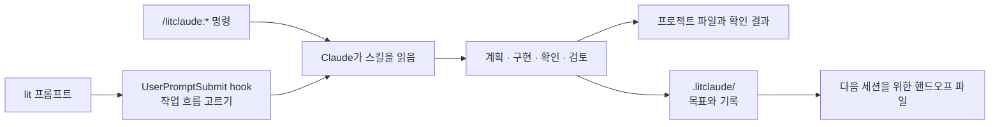

<p align="center"><picture><source media="(prefers-reduced-motion: reduce)" srcset="./docs/assets/cover-motion-still.webp" /></picture></p>

<h1 align="center">LitClaude</h1>
<p align="center"><strong>Keep the work lit.</strong></p>
<p align="center">Claude Code에서 세션마다 계획하고, 만들고, 확인한 뒤 다음 세션이 이어받을 기록을 남기게 돕는 플러그인입니다.</p>

<p align="center">
<a href="https://www.npmjs.com/package/@litfamily/litclaude"></a>
<a href="https://www.npmjs.com/package/@litfamily/litclaude"></a>
<a href="./LICENSE"></a>
<a href="https://github.com/wjgoarxiv/litclaude/stargazers"></a>
</p>

<p align="center"><a href="#설치">설치</a> &nbsp; <a href="#빠른-시작">빠른 시작</a> &nbsp; <a href="./docs/guide_ko-KR.md"> 안내서</a> &nbsp; <a href="./docs/skills_ko-KR.md">스킬</a> &nbsp; <a href="./docs/assets/readme/ignition-film.mp4"> 영상</a> &nbsp; <a href="./docs/guide_ko-KR.md#안전"> 안전</a> &nbsp; <a href="./README.md">English</a></p>

<!-- demo-gif --><p align="center"></p>

## 왜 LitClaude인가요

고치고 싶은 버그 하나, 만들고 싶은 화면 하나, 끝내고 싶은 프로젝트 하나. Claude Code에
맡기는 건 한 줄이면 됩니다. 어려운 건 그다음입니다. 대화가 길어지면 컨텍스트가 압축되고,
세션이 끝나면 다음에는 어디까지 했는지부터 다시 짚어야 합니다. 무엇을 정했고, 무엇을
확인했고, 다음에 무엇을 할지. 게다가 "다 됐습니다"가 모델의 말뿐인 경우도 많습니다.

LitClaude는 세션마다 따라갈 순서를 줍니다. 요청에 `lit`을 붙이면 Claude가 목표부터 고정하고,
실패하는 테스트를 먼저 쓰고, 실제로 만든 것을 확인한 뒤 결과를 기록합니다. 큰 변경은 `lit plan`으로
계획을 먼저 세우고, 승인한 뒤에 고칩니다. 작업을 멈출 때는 핸드오프 파일이 목표와
결과, 다음 할 일을 프로젝트에 남기고, 다음 세션은 그 파일을 읽고 이어갑니다. 세션을 돌리고
모델을 고르는 건 여전히 Claude Code이고, LitClaude는 일하는 방식을 더할 뿐입니다.

## 설치

Node.js와 npm, 그리고 Claude Code가 있으면 됩니다. 아무 터미널에서나 실행하세요.

```bash
npx @litfamily/litclaude@latest install
```

처음 실행하면 npx가 패키지를 설치할지 묻는데, `y`로 답하면 됩니다. 이어서 설치 프로그램이
플러그인을 등록하고 LitClaude 상태 줄을 붙인 뒤 두 가지를 묻습니다. 상태 줄 색상과, 쓰고 싶다면
출력 스타일입니다. 기본값으로 바로 가려면 `install` 뒤에 `--yes`를 붙이세요. 실제로 바꾸지 않고
무엇이 바뀌는지만 보려면 `--dry-run install` 순서로 씁니다:
`npx @litfamily/litclaude@latest --dry-run install`. 새로 설치하면 권한 규칙을 하나도 더하지 않는
`safe` 권한 모드로 시작하고, 나머지 Claude 설정은 그대로 둡니다. 영상 스킬에 필요한 렌더링
엔진과 글꼴도 함께 내려받기 때문에 처음 설치는 조금 더 걸립니다.
[권한 모드, 버전 고정, 전역 설치와 모든 스위치](./docs/guide_ko-KR.md#설치-상세)

상태 줄이나 설치 프로그램 없이 플러그인만 쓰고 싶다면 Claude Code에서 LitFamily 마켓플레이스로
추가할 수도 있습니다.

```text
/plugin marketplace add wjgoarxiv/litfamily
/plugin install litclaude@litfamily
```

두 방법 중 하나만 고르세요. 두 경로로 모두 켜면 hook이 두 번 실행됩니다.
[npm 설치와 마켓플레이스 중 고르기](./docs/migration.md#scoped-npm-migration)

설치를 코딩 에이전트에게 맡길 수도 있습니다. 아래 프롬프트를 붙여 넣으면 에이전트가 환경을
확인하고, 무엇이 바뀌는지 보여 준 뒤, 내가 좋다고 답해야 설치를 시작합니다.

```text
이 컴퓨터에 Claude Code 플러그인 LitClaude를 설치해 주세요.

- 공식 npm 패키지 @litfamily/litclaude만 사용하세요. 저장소를 복제하거나 다른 것을
  설치하지 마세요.
- 무엇이든 바꾸기 전에 Node.js, npm, Claude Code가 설치되어 있는지 확인한 뒤 다음을 실행하세요.
  npx @litfamily/litclaude@latest --dry-run install --yes
  무엇이 바뀌는지 보여 주고, 진행할지 물어본 다음 제 답을 기다리세요.
- 제가 좋다고 하면 npx @litfamily/litclaude@latest install --yes 를 실행하세요.
  (--yes는 상태 줄 색상과 출력 스타일을 기본값으로 둡니다. 나중에 제 터미널에서 설치를
  다시 실행해 고를 수 있습니다.)
- 그다음 npx @litfamily/litclaude@latest doctor 를 실행하고 결과를 알려 주세요. 마지막 줄이
  DOCTOR_PASS여야 합니다. 그렇지 않으면 실패한 줄을 보여 주고 거기서 멈추세요.
- 마지막으로, 플러그인이 로드되도록 Claude Code를 종료했다가 다시 시작하라고 알려 주세요.
```

## 빠른 시작

프로젝트 폴더에서 평소처럼 Claude Code를 실행하고 `lit`을 입력합니다.

```bash
claude
```

```text
lit
```

위 그림 같은 활성화 안내가 나오면 작은 작업 하나를 맡겨 보세요.

```text
외부 의존성 없이 HTML 파일 하나로 할 일 목록을 만들어줘.
추가·완료·삭제 동작을 구현하고, 확인한 내용과 다음 행동을 남겨줘.
```

Claude의 답은 **🔥 LIT IGNITED · lit-loop 🔥**로 시작해 목표와 확인 항목을 차례로 처리하고,
무엇을 확인했고 다음에 무엇을 할지로 끝납니다. 그다음 HTML을 직접 열어 세 동작을 하나씩
눌러 보세요. 버튼이 제대로 작동하는지는 그렇게 해 봐야 압니다. Claude가 브라우저를 쓸 수 없는
환경이었다면 화면과 클릭은 아직 확인하지 못했다고 적어 달라고 하세요.
[설치 화면, doctor, 상태 줄 그림](./docs/guide_ko-KR.md#화면에-나오는-모습)

하루 작업을 마칠 때는 `handoff`를 입력하고 알려 주는 파일 경로를 적어 두세요. 다음 세션에서
같은 프로젝트를 열고, Claude에게 그 파일을 읽고 현재 상태를 확인한 뒤 다음 할 일을 말해 달라고
하면 됩니다.

## LIT 카드

작업하는 동안 LitClaude는 프롬프트 바로 위에 작은 카드를 띄워 둡니다. 지금 어떤 작업 흐름이
돌고 있는지, 어디까지 왔는지, 어떤 스킬을 썼는지를 보여 주기 때문에 대화를 거슬러 올라가지
않아도 Claude가 하는 일을 따라갈 수 있습니다. 위쪽 테두리에는 작업 흐름의 이름과 단계가,
첫 줄에는 계획에서 작업을 거쳐 리뷰로 가는 흐름이, 둘째 줄에는 실행된 LitFamily 스킬마다 칩이
하나씩 놓이고, 아래쪽 테두리는 상태 줄의 컨텍스트, 5시간과 1주 사용량, Git 브랜치를 다시 보여 줍니다.

아직 아무것도 돌지 않을 때는 카드가 쉬면서 시작하는 방법을 알려 줍니다.

<p align="center"></p>

`lit`을 붙여 요청하면 카드가 작업 흐름의 이름을 띄우고, 지금 단계를 채우고, 요청을 맡은
스킬의 칩을 밝힙니다.

<p align="center"></p>

Claude가 일하는 동안 카드는 가만히 있지 않습니다. LIT 알약이 분홍에서 주황으로 천천히
숨 쉬듯 빛나고, 지금 단계와 스킬 칩 위로 빛이 한 번씩 지나가고, 불꽃 하나가 위쪽 테두리를 따라 갔다가
아래쪽 테두리로 돌아옵니다. 한눈에 봐도 LitClaude가 아직 일하는 중인지 알 수 있습니다.

턴이 끝나면 카드는 다시 idle로 돌아가고 움직임도 멈춥니다. 칩은 회색이 되어 최근 스킬로 남기 때문에 마지막에
무엇이 돌았는지 계속 알 수 있습니다.

<p align="center"></p>

카드는 Claude Code 2.1.287 이상의 터미널과 Claude 데스크톱 앱의 Code 탭에서 나옵니다. 앱도
같은 설정 파일을 읽기 때문에 설치 프로그램이 둘 다 준비해 둡니다. 설치한 뒤 앱에서 새 세션을
열면 됩니다. 카드는 세션 내내 떠 있고, 작업할 때만 보고 싶다면 `/config`의 LitClaude 항목에서
`band`를 `auto`로, 숨기려면 `off`로 바꾸세요. 움직임을 줄이려면 `motion`을 `subtle`로, 멈추려면
`off`로 두면 됩니다. 데스크톱 앱에는 이 설정을 바꾸는 화면이 없으니 터미널에서 바꾸세요.

```bash
npx @litfamily/litclaude@latest config             # 지금 설정 보기
npx @litfamily/litclaude@latest config band auto   # motion subtle, glyphs basic도 같은 방식
```

[카드가 보여 주는 모든 것](./docs/hooks.md#the-lit-band-claude-code-mod)

## 자동 핸드오프

세션이 길어지면 Claude의 컨텍스트 창이 차고, Claude Code가 대화를 압축할 때 작업의 세부 내용이
요약에서 빠질 수 있습니다. 자동 핸드오프를 켜 두면 아직 여유가 있을 때 Claude가 핸드오프 파일을
쓰고, 압축이 끝난 뒤 LitClaude가 그 파일을 다시 읽어 줍니다. 그래서 세션의 나머지는 내가 남긴
기록에서 이어집니다.

직접 켜고 비율을 정하기 전까지는 꺼져 있습니다. 프롬프트 전체로 `lit-handoff auto on 65`처럼
1부터 99 사이의 정수를 붙여 입력하면 LitClaude가 한 줄로 답하고 다른 작업은 시작하지 않습니다. 나중에 `status`로 지금 설정을 확인하고, `off`로
끄면 정해 둔 비율은 다음을 위해 남습니다.

<p align="center"><picture><source media="(prefers-color-scheme: dark)" srcset="./docs/assets/handoff/settings-dark.webp" /></picture></p>

설정은 Claude Code를 시작한 프로젝트 폴더마다 따로 저장됩니다. 비율은 Claude Code가 스스로
압축하는 지점보다 낮게 고르세요. 압축이 먼저 일어나면 되살릴 핸드오프가 없습니다. 켜져 있는
동안 상태 줄에 `handoff@65%`가 보입니다.

턴이 끝날 때 컨텍스트가 정한 비율에 닿아 있으면, Stop 훅이 Claude에게 멈추기 전에
핸드오프를 쓰라고 합니다. Claude Code는 플러그인이 압축을 시작할 방법을 주지 않기 때문에,
Claude가 한 줄로 알려 주면 `/compact`는 직접 실행합니다. 압축이 끝나면 LitClaude가 방금 쓴
핸드오프를 대화에 다시 읽어 넣습니다.

<p align="center"><picture><source media="(prefers-color-scheme: dark)" srcset="./docs/assets/handoff/compact-dark.webp" /></picture></p>

Claude Code를 시작하기 전에 셸에서 켤 수도 있습니다. 두 환경 변수가 저장된 설정보다 우선하고,
doctor가 지금 적용 중인 설정을 알려 줍니다.

<p align="center"><picture><source media="(prefers-color-scheme: dark)" srcset="./docs/assets/handoff/env-dark.webp" /></picture></p>

[자동 핸드오프가 단계별로 어떻게 돌아가는지](./docs/guide_ko-KR.md#자동-핸드오프)

## 무엇을 할 수 있나요

LitClaude에는 직접 시작하는 스킬 35개와 알아서 도는 스킬 3개, 슬래시 명령 16개, 에이전트
11개가 들어 있습니다. 평소에는 그중 몇 개만 쓰게 됩니다.

### 작업 루프

어떤 요청에든 `lit`을 붙이세요. Claude가 목표를 고정하고, 실패하는 테스트를 먼저 쓰고, 그
테스트를 통과하는 가장 작은 변경을 한 뒤 실제 결과를 확인하고 프로젝트에 기록을 남깁니다.

```text
src/dates.js의 날짜 파싱 버그를 고치고, 고치기 전에는 실패하는 테스트도 추가해줘 lit
```

### 계획 먼저, 그다음 구현

큰 변경이라면 `lit plan`이 번호 붙은 작업과 작업마다 예/아니오로 답할 수 있는 확인 항목을
담은 계획을 쓰고, 아직 아무것도 고치지 않습니다. 계획을 승인하면 `/litclaude:start-work`가
작업을 하나씩 실행하고, 확인 항목을 통과한 작업에만 체크 표시를 합니다.

```text
lit plan 보고서 페이지에 CSV 내보내기를 테스트와 함께 추가해줘
/litclaude:start-work <작성된 계획 파일>
```

### 병합 전에 한 번 더 보기

`lit review`는 같은 변경과 그 근거를 서로 독립된 다섯 갈래의 검토로 읽습니다. 찾은 문제를
먼저 보고하고, 고치는 일은 따로 합니다.

```text
lit review 이 브랜치의 변경 사항
```

### 출처가 남는 조사

`lit research`는 질문을 나누어 여러 검색을 동시에 공개 자료에 보내고, 답에서 사실과 불확실한
부분을 구분합니다. 로그인이나 유료 벽을 만나면 멈춥니다.

```text
lit research 작은 웹 앱에서 SQLite 쓰기 속도에 가장 큰 영향을 주는 설정은?
```

### 발표자료, 보고서, 한국어 문장 다듬기

발표자료나 보고서를 부탁하면서 끝에 `lit`을 붙이면, 네이티브 차트가 들어간 편집 가능한
`.pptx`나 서식을 갖춘 `.docx`가 나옵니다. 글꼴은 Pretendard이고, 렌더링한 페이지를 한 장씩
확인한 뒤 넘겨 줍니다. `lit-humanizer`는 딱딱한 한국어나 영어 문장을 사실은 그대로 두고 다시
씁니다.

```text
팀 워크숍 발표자료 만들어줘 lit
새 온보딩 흐름에 대한 두 쪽짜리 프로젝트 제안서 써줘 lit
lit-humanizer docs/intro.md
```

### 다음 세션으로 이어가기

`handoff`는 목표, 확인한 것, 남은 일을 담은 이어가기 파일을 씁니다. 자동 핸드오프를 켜면 긴
세션을 Claude Code가 압축하기 전에 이 파일을 대신 써 둡니다. `lit-handoff auto on 60`처럼 직접
비율을 정하기 전까지는 꺼져 있습니다.

[전체 입력 경로](./docs/guide_ko-KR.md#무엇을-입력하나요)와 [그림으로 보는 전체 스킬](./docs/skills_ko-KR.md)

## 작동 방식



설치 프로그램은 플러그인을 Claude Code의 플러그인 폴더에 복사하고 등록합니다. 평범한 프롬프트를
보내면 hook이 그것을 읽고 어떤 작업 흐름이 맞는지 짧게 적어 Claude에게 넘기고, 슬래시 명령은
곧장 해당 스킬로 갑니다. 다른 hook은 세션을 시작할 때 프로젝트 규칙을 읽어 들이고, 파일을 고친
뒤에는 무엇을 확인할지 Claude에게 일러 줍니다. 목표가 걸린 작업의 기록은 프로젝트의 `.litclaude/`
폴더에 남습니다. 이 폴더에는 `*` 한 줄짜리 `.gitignore`가 들어 있어서, 사용자의 ignore 파일을
바꾸지 않고도 Git이 이 폴더를 건너뜁니다. 세션과 세션 사이에 따로 돌아가는 것은 없습니다.
[hook 자세히 보기](./docs/hooks.md)와 [네트워크로 오가는 것](./docs/privacy.md)

## 요구 사항, 업데이트, 제거

- **필요한 것:** Node.js와 npm, Claude Code. 발표자료와 문서 스킬은 처음 쓸 때 버전을 고정한
  도구를 `~/.cache/litclaude/office-runtime`에 설치합니다.
- **확인:** `npx @litfamily/litclaude@latest doctor`가 설치된 플러그인, 상태 줄, 권한 모드를
  점검하고 `DOCTOR_PASS`로 끝납니다.
- **업데이트:** `npx @litfamily/litclaude@latest update`
- **제거:** `npx @litfamily/litclaude@latest uninstall`은 LitClaude가 관리하는 플러그인, 상태 줄,
  권한, 로컬 상태 항목만 지웁니다. 누가 손댄 설치라면 건드리지 않고
  [소유권 충돌 안내](./docs/migration.md#ownership-conflicts)를 알려 줍니다.
- **마켓플레이스로 설치했다면:** 위 명령은 npm 설치만 관리합니다. 마켓플레이스로 추가한 플러그인에는
  LitClaude 상태 줄이 없고, 업데이트와 제거는 Claude Code의 `/plugin` 메뉴에서 합니다.

## 더 알아보기

- [안내서](./docs/guide_ko-KR.md): 설치 옵션, 화면에 나오는 모습, 홍보 영상, 전체 입력 경로, 자동
  핸드오프, 발표자료와 문서, 상태 줄, 안전, Claude Code 연결 구조를 자세히 다룹니다.
- [전체 스킬](./docs/skills_ko-KR.md): 스킬 35개와 자동 점검을 한 줄씩 그림과 함께 보여 줍니다.
- [Jev 스킬 힌트](./docs/jev_ko-KR.md): 프롬프트에 맞는 스킬을 제안하는 선택 기능으로, 기본은
  꺼져 있습니다. 켜면 프롬프트가 외부 서비스 TypeSafe로 전송되니 먼저 읽어 보세요.
- [hook](./docs/hooks.md), [에이전트](./docs/agents.md), [개인정보와 네트워크](./docs/privacy.md),
  [이전과 소유권 충돌](./docs/migration.md),
  [패키지 이름 이전과 마켓플레이스 선택](./docs/migration.md#scoped-npm-migration), [Claude Code `/goal` 지원 범위](./docs/native-goal-surface.md),
  [작업 흐름 호환성 점검](./docs/workflow-compatibility-audit.md)
- [개발](./docs/development_ko-KR.md): checkout 검증 명령, 플러그인 로컬 로드, 프로젝트 지도
- [변경 이력](./CHANGELOG.md)과 [English README](./README.md)
- [LitFamily](https://github.com/wjgoarxiv/litfamily): 다른 코딩 에이전트를 위한 같은 방식의 도구

## LITFAMILY

표지의 아머드 로봇 다섯 대는 LitFamily 제품 다섯 개를 뜻합니다. 각 제품은 자기 호스트에서 따로
동작하니, 쓰는 것 하나만 설치하면 됩니다. 표지는 브랜드 모션이며 실제 Claude 세션을 녹화한 것은
아닙니다. [Ignition 영상](./docs/assets/readme/ignition-film.mp4)도 같은 분위기의 짧은 브랜드
영상입니다.

<p align="center"></p>

<details>
<summary>ASCII 로고 복사</summary>

```text
                             ▄▄▄▄
                   ▗███▌   ▗██████▖
 ▗▄▄▄▄▄          ▗▟████▌   ▝██████▘
 ▐█████        ▗▟██████▌    ▝▀▜█▀▘
 ▐█████      ▗▟███████▄▄▄▄▄▄▄▄▄▄▄▄▄▄▄▄▄▄▄▄
 ▐█████    ▗▟█████████████████████████ ▐█▀
 ▐█████    ████████████████████████████▀
 ▐█████    ██▛▘   ▄ ▄▄▄▄▖▄▄▄▄▄▄▄▄▄▄▄▄▄▖
 ▐█████    ▀    ▄██ ████▌█████████████▌
 ▐█████       ▄████ ████▌█████████████▌
 ▐█████     ▄█████▛                                 claude
 ▐█████  ▗▟█████▀▘       ▄▄▄▄▄     ▗▖               ──────────────
 ▐█████ ▐█████▀          █████     ▐▛▀              hermes · codex
 ▐█████ ▐███▀            █████                      opencode · grok
 ▐█████ ▐█▀              █████
 ▐█████ ▝                █████
 ▐█████▄▄▄▄▄▄▄▖          █████
 ▐███████████▛           █████
 ▐██████████▀            █████

```

</details>

같은 프로젝트를 두 번 설명하는 수고를 LitClaude가 덜어 줬다면, GitHub 스타 하나가 다른 Claude Code
사용자가 이 프로젝트를 찾는 데 도움이 됩니다.

기여하려면 [기여 안내](./CONTRIBUTING.md)부터 읽어 주세요. 질문은 [지원](./SUPPORT.md)으로,
보안 문제는 [보안](./SECURITY.md)에 적힌 방법으로 알려 주시고, [행동 강령](./CODE_OF_CONDUCT.md)은
모든 참여자에게 적용됩니다. LitClaude는 [MIT 라이선스](./LICENSE)로 배포합니다.
