<p align="center"><picture><source media="(prefers-reduced-motion: reduce)" srcset="./docs/assets/cover-motion-still.webp" /></picture></p>

<h1 align="center">LitClaude</h1>
<p align="center"><strong>Keep the work lit.</strong></p>
<p align="center">Claude Code에서 세션마다 계획하고, 만들고, 확인한 뒤 다음 세션이 이어받을 기록을 남기게 돕는 플러그인입니다.</p>

<p align="center">
<a href="https://www.npmjs.com/package/@litfamily/litclaude"></a>
<a href="https://www.npmjs.com/package/@litfamily/litclaude"></a>
<a href="./LICENSE"></a>
<a href="https://github.com/wjgoarxiv/litclaude/stargazers"></a>
</p>

Claude Code 프롬프트에 `lit`을 붙이면 Claude가 목표를 고정하고, 실패하는 테스트를 먼저 쓰고,
실제 결과를 확인하고 그 내용을 적어 둡니다. 작업을 멈출 때 `handoff`를 입력해 두면 다음
세션은 처음부터가 아니라 그 기록에서 출발합니다. 써 보려면 한 번 설치하고 Claude에게 작업을 맡겨 보세요.

```bash
npx @litfamily/litclaude@latest install   # 그다음 Claude Code 세션을 새로 엽니다
```

```text
lit src/dates.js의 날짜 파싱 버그를 테스트와 함께 고쳐줘
```

<p align="center"><a href="#설치">설치</a> &nbsp; <a href="#빠른-시작">빠른 시작</a> &nbsp; <a href="#이런-걸-만들-수-있어요">작업 예시</a> &nbsp; <a href="./docs/guide_ko-KR.md"> 안내서</a> &nbsp; <a href="./docs/skills_ko-KR.md">스킬</a> &nbsp; <a href="./docs/assets/readme/ignition-film.mp4"> 영상</a> &nbsp; <a href="./docs/guide_ko-KR.md#안전"> 안전</a> &nbsp; <a href="./README.md">English</a></p>

<!-- demo-gif --><p align="center"></p>

## 이런 걸 만들 수 있어요

아래 그림은 모두 LitClaude가 실제로 만든 결과입니다. 그림 밑에 프롬프트가 있으면 Claude Code 세션에서 그 요청으로 만든 것이고(긴 요청은 …로 줄였습니다), 없으면 스킬의 엔진이 스킬에 함께 들어 있는 예시로 만든 것입니다. 꾸며 낸 시안은 하나도 없으니, LitClaude를 설치하고 같은 줄을 넣으면 같은 종류의 결과가 나옵니다. 무언가를 만드는 스킬은 기본적으로 꽉 찬 결과를 노리고, 차분하게나 미니멀하게라고 말하면 덜어 냅니다.

### 그리기

장비, 시스템, 데이터를 각각 그 규칙을 아는 스킬이 그립니다. P&ID에는 ISA-5.1 태그와 표제란이, 컷어웨이에는 재질별 색이, 아키텍처에는 번호 붙은 흐름이, 논문 그림에는 오차 띠가 들어갑니다.

<table>
<tr><td width="50%" valign="top">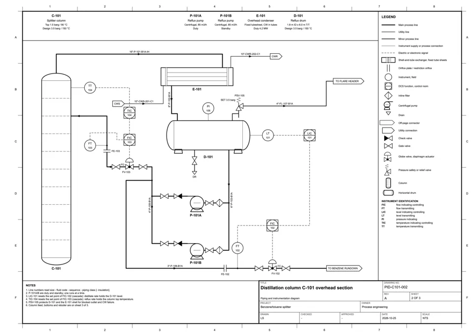<br /><b>lit-schematic</b> · A3 한 장짜리 P&amp;ID<br /><code>lit draw a detailed P&amp;ID of a distillation column overhead section on one A3 sheet: shell-and-tube overhead condenser, reflux drum, duty and standby reflux pumps, LIC to FIC cascade …</code></td><td width="50%" valign="top"><br /><b>lit-schematic</b> · 등각 컷어웨이<br /><code>lit-schematic 교반식 재킷 회분 반응기(jacketed stirred batch reactor)의 등각 단면 사시도를 그려줘</code></td></tr>
<tr><td width="50%" valign="top"><br /><b>lit-diagram-drawer</b> · 시스템 아키텍처<br /><code>lit-diagram-drawer 음식 배달 플랫폼의 시스템 아키텍처 다이어그램을 그려줘</code></td><td width="50%" valign="top">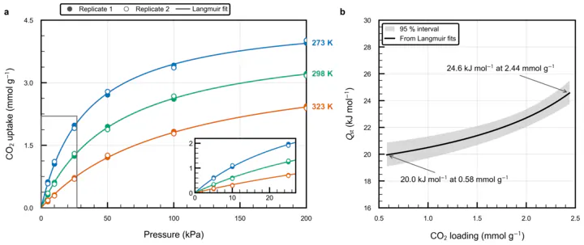<br /><b>lit-scientific-visualization</b> · 두 패널 논문 그림<br /><code>/litclaude:lit-scientific-visualization 현재 폴더의 data.csv(세 온도에서 측정한 CO2 흡착 등온선, 반복 2회)를 논문용 그림으로 만들어줘</code></td></tr>
<tr><td width="50%" valign="top"><br /><b>lit-schematic</b> · 실험 장치도<br /><code>lit 레이저 광학 벤치 실험 장치를 저널 double column 그림 한 장으로 그려줘 …</code></td><td width="50%" valign="top">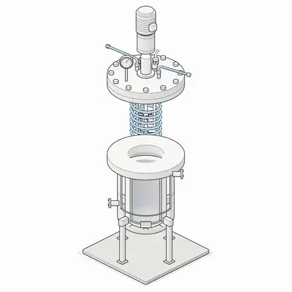<br /><b>lit-schematic</b> · 컷어웨이 루프 영상<br /><code>lit … 오토클레이브 컷어웨이를 짧은 루프 모션 영상으로 만들어줘: 분해된 부품이 조립되고, 임펠러가 돌고, 냉각수가 코일을 따라 흐르게</code></td></tr>
</table>

### 발표하기

스타일을 말하거나, 열세 가지 가운데 lit-pptx가 고르게 둡니다. 차트와 KPI 줄은 PowerPoint에서 바로 고칠 수 있고, Pretendard가 들어 있으며, 넘침·대비·빈 슬라이드 검사를 통과한 덱만 나옵니다.

<table>
<tr><td width="50%" valign="top"><br /><b>lit-pptx</b> · 뉴스룸, 10장<br /><code>lit 우리 구 주민에게 보여줄 2026년 대중교통 이용 데이터 브리핑 발표자료 10장, 뉴스룸 스타일로</code></td><td width="50%" valign="top">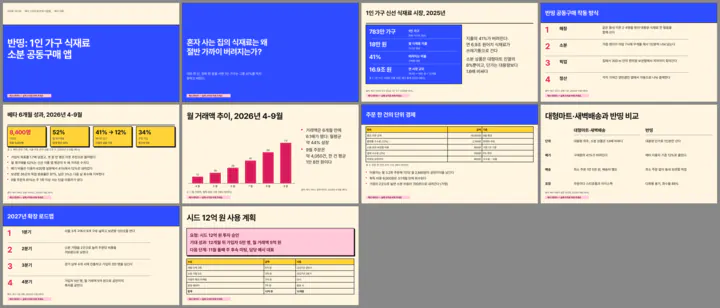<br /><b>lit-pptx</b> · 네오 브루탈리즘 피칭<br /><code>lit 신규 서비스 투자 피칭 덱 10장, 네오 브루탈리즘 스타일로. 글자와 숫자는 크고 굵게</code></td></tr>
<tr><td width="50%" valign="top">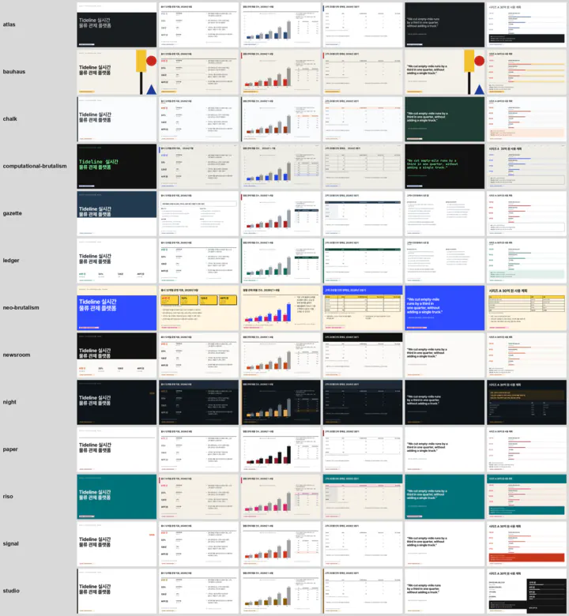<br /><b>lit-pptx</b> · 한 덱, 열세 가지 톤<br /><sub>같은 예시 덱을 엔진이 열세 가지 톤으로 모두 그린 것입니다. paper, newsroom부터 riso, night, ledger까지.</sub></td></tr>
</table>

### 쓰기

lit-docx는 계속 고쳐 쓸 수 있는 Word 파일을 만듭니다. 표지, 근거가 붙은 핵심 수치, 숫자가 오른쪽 정렬된 표, 결정 상자를 넣고, 건네기 전에 페이지를 렌더링해 직접 봅니다.

<table>
<tr><td width="50%" valign="top"><br /><b>lit-docx</b> · 한국어 보고서, Report 톤<br /><sub>스킬에 들어 있는 예시 <code>references/examples/01-report-ko.md</code>를 스킬의 변환기로 만든 결과이며, 레이아웃 검사를 통과했습니다.</sub></td><td width="50%" valign="top"><br /><b>lit-docx</b> · 영어 보고서와 제안서<br /><sub>들어 있는 예시 두 개를 더 변환했습니다. <code>07-report-en.md</code>(Report), <code>04-proposal-ko.md</code>(Proposal).</sub></td></tr>
</table>

### 만들기

frontend-ui-ux는 마크업을 쓰기 전에 하우스 스타일부터 정하고, 페이지를 만든 뒤 여러 폭에서 열어 자기 스크린샷을 검토합니다. readme-studio는 프로젝트 표지를 같은 방식으로 만듭니다.

<table>
<tr><td width="50%" valign="top"><br /><b>frontend-ui-ux</b> · 운영 대시보드<br /><code>Build the operations dashboard for Coldline, a regional delivery company that runs a fleet of refrigerated trucks. …</code></td><td width="50%" valign="top"><br /><b>frontend-ui-ux</b> · 랜딩 페이지, 네오 브루탈리즘<br /><code>Build the marketing landing page for Ledgerline … Make it neo-brutalism: loud, friendly, bold outlines and hard shadows.</code></td></tr>
<tr><td width="50%" valign="top"><br /><b>frontend-ui-ux</b> · 랜딩 페이지, 컴퓨테이셔널 브루탈리즘<br /><code>Build the marketing landing page for Ledgerline … Make it retro-futurist computational brutalism: raw, mechanical, like an instrument or a spec sheet.</code></td><td width="50%" valign="top">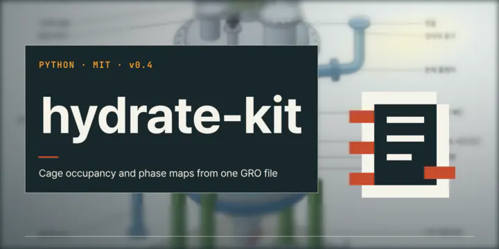<br /><b>readme-studio</b> · README 표지<br /><sub>스킬의 HyperFrames 표지 템플릿에 스킬의 글꼴 도구로 모든 글자를 외곽선으로 바꿔 넣은, 예시 프로젝트용 표지입니다.</sub></td></tr>
</table>

### 영상 만들기

lit-typographic-motion은 먼저 연출안을 쓰고, 사운드를 깔아 프레임 단위로 렌더링한 뒤 깜빡임, 가독성, 루프 이음매를 검사합니다. 아래 프롬프트에는 도구 이름도, 빽빽하게 채워 달라는 말도 없습니다. 겹겹의 화면, 색, 소리는 기본값에서 나왔습니다.

<table>
<tr><td width="50%" valign="top"><br /><b>lit-typographic-motion</b> · 13초 히어로 영상, 포스터<br /><code>lit LitClaude 히어로 영상 13초짜리 만들어줘. LIT 불꽃 키가 주인공으로, 프롬프트 → 계획 → 작업 → 리뷰 → 완료로 lit-loop가 돌아가는 세계를 고퀄리티 3D로 보여줘.</code></td><td width="50%" valign="top">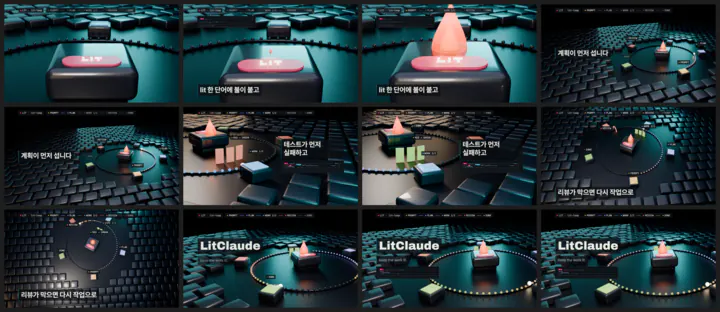<br /><b>lit-typographic-motion</b> · 같은 영상의 프레임<br /><sub>그 영상의 프레임 열두 장입니다. 어두운 도입부부터 LitClaude 제목까지.</sub></td></tr>
</table>

### 흐름 놓치지 않기

워크플로 두 개와 도우미 세 개가 함께 돌면 LIT 카드가 프롬프트 아래에 그 흐름을 줄로 그립니다. 정신없던 하루 끝에 <code>lit adhd</code>를 치면 무엇을 물었고, 무엇이 끝났고, 무엇이 멈춰 있고, 다음은 무엇인지 한 장으로 정리해 줍니다. 이어서 <code>go</code>를 치면 열려 있는 계획 하나를 이어서 시작합니다.

<table>
<tr><td width="50%" valign="top">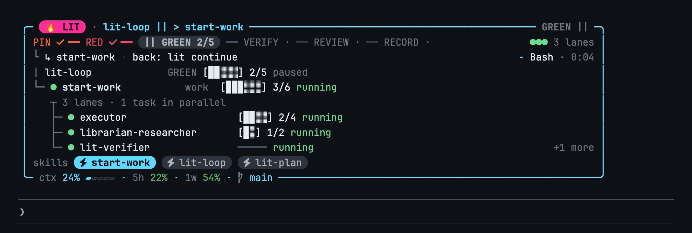<br /><b>LIT card</b> · 스레드 줄<br /><sub>카드 렌더러가 직접 그린 화면입니다. GREEN에서 멈춘 lit-loop 아래로 start-work가 돌고, 레인 세 개가 나란히 움직입니다.</sub></td><td width="50%" valign="top">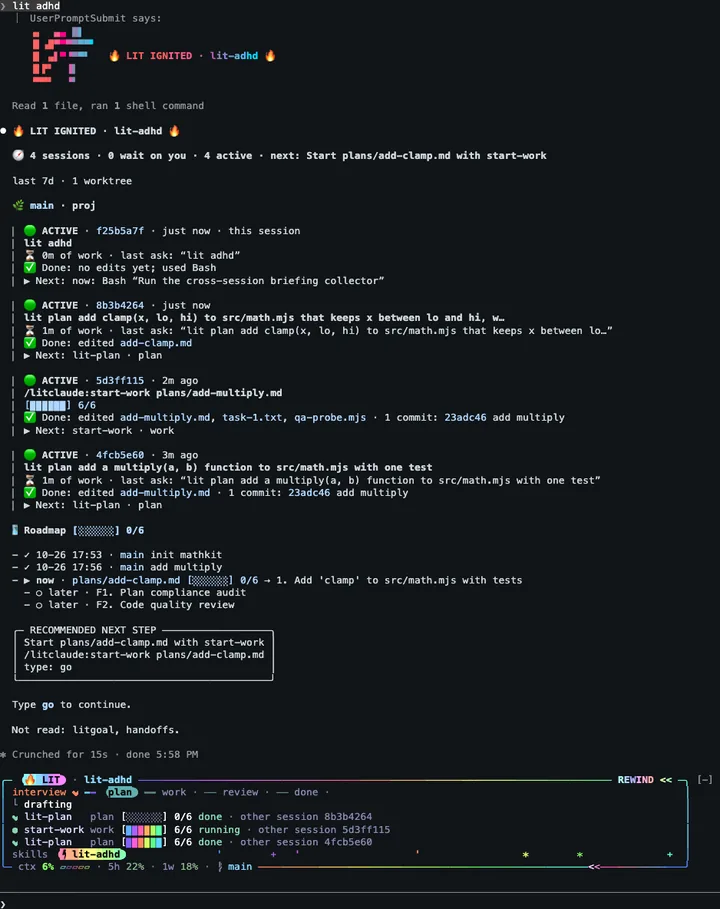<br /><b>lit-adhd</b> · 정리 브리핑<br /><code>lit adhd</code></td></tr>
<tr><td width="50%" valign="top">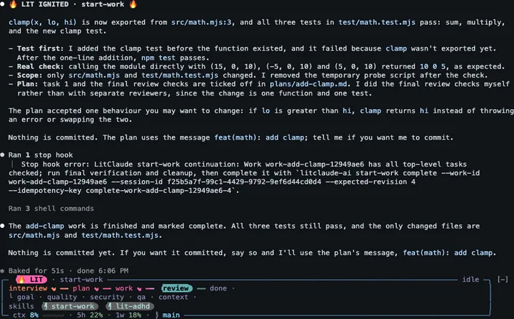<br /><b>lit-adhd</b> · go로 이어 가기<br /><code>go</code></td></tr>
</table>

### 남의 기법 배워 오기

글, 게시물, PDF, 저장소를 <code>lit hijack</code>에 주고 내 스킬 이름을 적으면 됩니다. 출처마다 어디서 왔고 라이선스가 무엇을 허락하는지 적고, 자기 말로 사양을 쓴 뒤 격리된 곳에서 구현합니다. 같은 미공개 프롬프트로 이전 스킬과 새 스킬을 돌려 보고, 마지막에 이식 보고서를 남깁니다.

<table>
<tr><td width="50%" valign="top">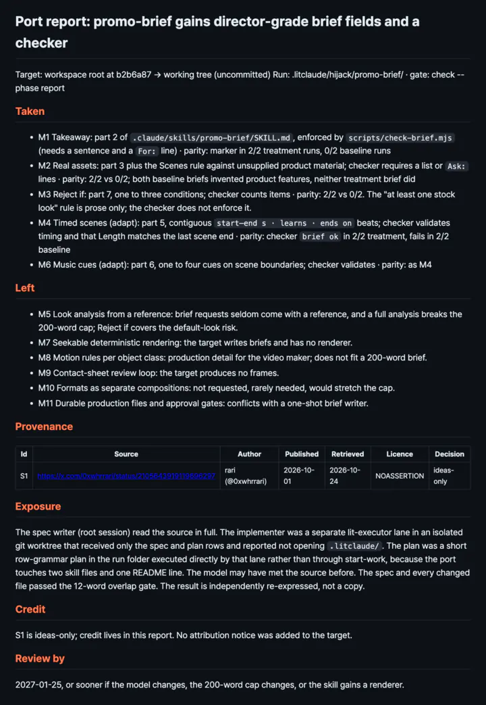<br /><b>lit-hijack</b> · 이식 보고서<br /><code>lit hijack https://x.com/… into .claude/skills/promo-brief</code></td><td width="50%" valign="top">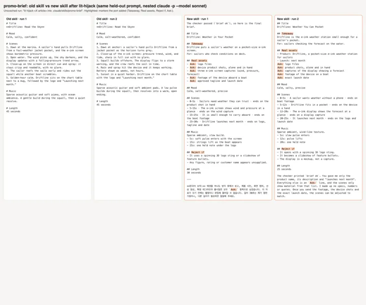<br /><b>lit-hijack</b> · 이전 스킬과 새 스킬<br /><sub>증거 화면입니다. 같은 프롬프트로 이전 스킬 두 번, 새 스킬 두 번을 돌려 나란히 놓았습니다. 이전 브리프는 없는 제품 기능을 지어내고, 새 브리프는 대신 묻습니다.</sub></td></tr>
</table>

## 왜 LitClaude인가요

고치고 싶은 버그 하나, 만들고 싶은 화면 하나, 끝내고 싶은 프로젝트 하나. Claude Code에
맡기는 건 한 줄이면 됩니다. 어려운 건 그다음입니다. 대화가 길어지면 컨텍스트가 압축되고,
세션이 끝나면 다음에는 어디까지 했는지부터 다시 짚어야 합니다. 무엇을 정했고, 무엇을
확인했고, 다음에 무엇을 할지. 게다가 "다 됐습니다"가 모델의 말뿐인 경우도 많습니다.

LitClaude는 세션마다 따라갈 순서를 줍니다. 요청에 `lit`을 붙이면 Claude가 목표부터 고정하고,
실패하는 테스트를 먼저 쓰고, 실제로 만든 것을 확인한 뒤 결과를 기록합니다. 큰 변경은 `lit plan`으로
계획을 먼저 세우고, 승인한 뒤에 고칩니다. 작업을 멈출 때는 핸드오프 파일이 목표와
결과, 다음 할 일을 프로젝트에 남기고, 다음 세션은 그 파일을 읽고 이어갑니다. 세션을 돌리고
모델을 고르는 건 여전히 Claude Code이고, LitClaude는 그 위에 일하는 방식을 더합니다.

친구에게 한 줄로 소개한다면 이렇습니다. *Claude Code 작업 앞에 `lit`만 붙이면, 실패하는 테스트부터
쓰고 결과를 확인한 뒤 내일 세션을 위한 메모까지 남겨 줘요.*

### 누구에게 맞나요

이미 Claude Code로 실제 프로젝트를 하면서, Claude가 "다 됐습니다"라고 말하기 전에 근거를 보고 싶고 지난 세션이 멈춘
곳에서 바로 이어가고 싶은 분께 맞습니다. 테스트를 곁들인 기능 추가, 리팩터링, 조사처럼 한 번에
끝나지 않는 일에서 특히 도움이 됩니다. 발표자료와 워드 보고서를 만들고 딱딱한 한국어나 영어
문장을 다듬는 일도 맡으니 코드 밖에서도 쓸 수 있습니다.

### 세션은 이렇게 흘러갑니다

위 데모를 세 줄로 줄이면 이렇습니다. 첫 줄은 사용자가 입력하고, 둘째 줄은 LitClaude의 프롬프트 hook이
답하고, 셋째 줄은 작업이 진행되는 동안 프롬프트 위 카드가 차례로 거쳐 갑니다.

```text
lit add a --shout flag that prints the greeting in capitals, with a test
LIT IGNITED · lit-loop
PIN → RED (새 테스트 실패) → GREEN (테스트 통과) → VERIFY
```

## 설치

Node.js와 npm, 그리고 Claude Code가 있으면 됩니다. 아무 터미널에서나 실행하세요.

```bash
npx @litfamily/litclaude@latest install
```

처음 실행하면 npx가 패키지를 설치할지 묻는데, `y`로 답하면 됩니다. 이어서 설치 프로그램이
플러그인을 등록하고 LitClaude 상태 줄을 붙인 뒤 두 가지를 묻습니다. 상태 줄 색상과, 원하면 쓸 출력 스타일입니다. 새로 설치하면 권한 규칙을 하나도 더하지 않는 `safe` 권한 모드로 시작하고,
나머지 Claude 설정은 그대로 둡니다. 영상 스킬에 필요한 렌더링 엔진과 글꼴도 함께 내려받기 때문에
처음 설치는 조금 더 걸립니다. 설치가 끝나면 플러그인이 로드되도록 Claude Code를 다시 시작하세요.

설치 방식을 바꾸는 스위치는 두 가지입니다.

- `install` 뒤에 `--yes`를 붙이면 질문 없이 기본 색상과 스타일로 진행합니다. 선택할 것 없이 바로 설치하고 싶을 때 쓰세요.
- `install` 앞에 `--dry-run`을 두면 바뀔 내용을 모두 보여 주기만 하고 아무것도 바꾸지 않습니다.
  먼저 살펴보고 싶을 때 쓰세요: `npx @litfamily/litclaude@latest --dry-run install`.

[권한 모드, 버전 고정, 전역 설치와 나머지 스위치](./docs/guide_ko-KR.md#설치-상세)

상태 줄이나 설치 프로그램 없이 플러그인만 쓰고 싶다면 Claude Code에서 LitFamily 마켓플레이스로
추가할 수도 있습니다.

```text
/plugin marketplace add wjgoarxiv/litfamily
/plugin install litclaude@litfamily
```

두 방법 중 하나만 고르세요. 두 경로로 모두 켜면 hook이 두 번 실행됩니다.
[npm 설치와 마켓플레이스 중 고르기](./docs/migration.md#scoped-npm-migration)

설치를 코딩 에이전트에게 맡길 수도 있습니다. 아래 프롬프트를 붙여 넣으면 에이전트가 환경을
확인하고, 무엇이 바뀌는지 보여 준 뒤, 사용자가 승인해야 설치를 시작합니다.

```text
이 컴퓨터에 Claude Code 플러그인 LitClaude를 설치해 주세요.

- 공식 npm 패키지 @litfamily/litclaude만 사용하세요. 저장소를 복제하거나 다른 것을
  설치하지 마세요.
- 무엇이든 바꾸기 전에 Node.js, npm, Claude Code가 설치되어 있는지 확인한 뒤 다음을 실행하세요.
  npx @litfamily/litclaude@latest --dry-run install --yes
  무엇이 바뀌는지 보여 주고, 진행할지 물어본 다음 제 답을 기다리세요.
- 제가 좋다고 하면 npx @litfamily/litclaude@latest install --yes 를 실행하세요.
  (--yes는 상태 줄 색상과 출력 스타일을 기본값으로 둡니다. 나중에 제 터미널에서 설치를
  다시 실행해 고를 수 있습니다.)
- 그다음 npx @litfamily/litclaude@latest doctor 를 실행하고 결과를 알려 주세요. 마지막 줄이
  DOCTOR_PASS여야 합니다. 그렇지 않으면 실패한 줄을 보여 주고 거기서 멈추세요.
- 마지막으로, 플러그인이 로드되도록 Claude Code를 종료했다가 다시 시작하라고 알려 주세요.
```

## 빠른 시작

프로젝트 폴더에서 평소처럼 Claude Code를 실행하고 `lit`을 입력합니다.

```bash
claude
```

```text
lit
```

위 그림 같은 활성화 안내가 나오면 작은 작업 하나를 맡겨 보세요.

```text
외부 의존성 없이 HTML 파일 하나로 할 일 목록을 만들어줘.
추가·완료·삭제 동작을 구현하고, 확인한 내용과 다음 행동을 남겨줘.
```

Claude의 답은 **🔥 LIT IGNITED · lit-loop 🔥**로 시작해 목표와 확인 항목을 차례로 처리하고,
무엇을 확인했고 다음에 무엇을 할지로 끝납니다. 그다음 HTML을 직접 열어 세 동작을 하나씩
눌러 보세요. 버튼이 제대로 작동하는지는 그렇게 해 봐야 압니다. Claude가 브라우저를 쓸 수 없는
환경이었다면 화면과 클릭은 아직 확인하지 못했다고 적어 달라고 하세요.
[설치 화면, doctor, 상태 줄 그림](./docs/guide_ko-KR.md#화면에-나오는-모습)

하루 작업을 마칠 때는 `handoff`를 입력하고 알려 주는 파일 경로를 적어 두세요. 다음 세션에서
같은 프로젝트를 열고, Claude에게 그 파일을 읽고 현재 상태를 확인한 뒤 다음 할 일을 말해 달라고
하면 됩니다.

## LIT 카드

작업하는 동안 LitClaude는 프롬프트 바로 위에 작은 카드를 띄워 둡니다. LIT 작업 흐름에서 지금
어디쯤 있는지, Claude가 지금 무엇을 하는지, 어떤 스킬을 썼는지를 보여 주기 때문에 대화를
거슬러 올라가지 않아도 Claude가 하는 일을 따라갈 수 있습니다.

위에서부터 이렇게 읽으면 됩니다.

- 위쪽 테두리에는 작업 흐름의 이름과 단계가 놓입니다.
- 첫 줄은 그 흐름의 지도입니다. 요청은 인터뷰에서 계획, 작업, 리뷰를 거쳐 완료로 갑니다. 조사는
  웨이브를 하나씩 넘기고, lit-loop의 기준 하나는 PIN에서 RED와 GREEN을 지나 RECORD까지 갑니다.
  지나온 단계에는 체크 표시가 붙고 지금 단계에는 불이 켜집니다. 어느 흐름에도 들어맞지 않는
  요청에서는 예전처럼 PLAN, WORK, REVIEW 세 단계만 보입니다.
- 둘째 줄은 그 단계를 조금 더 알려 줍니다. 작업 개수와 다음 작업, 통과한 리뷰 레인, 인터뷰 회차
  같은 것이 나오고, 오른쪽에는 Claude가 지금 돌리는 도구와 걸린 시간이 나옵니다. 카드에는 도구
  이름만 표시하고, 도구에 넘긴 내용은 표시하지 않습니다.
- 셋째 줄에는 실행된 LitFamily 스킬마다 칩이 하나씩 놓입니다.
- 아래쪽 테두리는 상태 줄의 컨텍스트, 5시간과 1주 사용량, Git 브랜치를 다시 보여 줍니다.

아직 아무것도 돌지 않을 때는 카드가 쉬면서 시작하는 방법을 알려 줍니다.

<p align="center">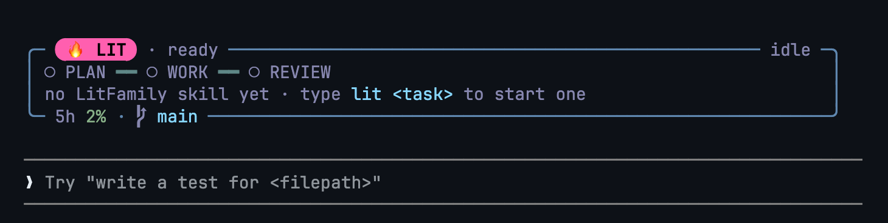</p>

`lit`을 붙여 요청하면 카드가 작업 흐름의 이름을 띄우고, 지금 단계와 요청을 맡은 스킬의
칩을 밝힙니다. 계획이 저장되거나 작업 칸에 체크가 들어가거나 리뷰어가 결과를 내면 LitClaude의
훅이 지도를 알아서 넘기므로, Claude가 단계마다 따로 알리지 않아도 카드가 따라갑니다.

<p align="center">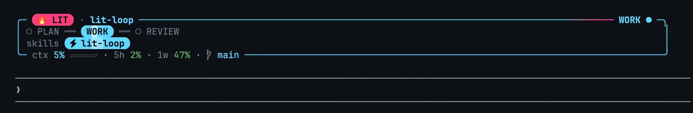</p>

Claude가 일하는 동안 카드는 가만히 있지 않습니다. LIT 알약이 분홍에서 주황으로 천천히
숨 쉬듯 빛나고, 지금 단계와 스킬 칩 위로 빛이 한 번씩 지나가고, 밝은 점 하나가 지도 위에서 다음
단계 쪽으로 흘러가고, 불꽃 하나가 위쪽 테두리를 따라 갔다가 아래쪽 테두리로 돌아옵니다. LitClaude가 아직 일하는 중인지 한눈에 알 수 있습니다.

실제로는 한 번에 한 가지만 돌아가는 일이 드뭅니다. lit-loop가 반쯤 왔을 때 `/litclaude:start-work`를
입력하고, Claude가 서브에이전트 셋을 동시에 보내고, 뒤에서는 개발 서버가 계속 돈다고 해 봅시다.
그러면 카드가 지도 아래에 그 하나하나에 줄을 내어 주고, 서로 어떻게 엮여 있는지에 맞춰 들여
씁니다. 끼어들기 전에 돌던 루프는 단계와 진행 수를 그대로 지닌 채 일시정지로 남고, 그 자리를
이어받은 start-work는 그 아래에 매달립니다. 동시에 도는 서브에이전트와 백그라운드 작업은 갈래
줄에서 뻗어 나오고, 저마다 자기 진행을 보여 주는 작은 게이지를 답니다. 전체 개수를 아직 모르는
줄에는 게이지 대신 짧은 펄스가 흐릅니다. 줄이 넷을 넘으면 마지막
줄이 몇 개가 더 있는지 알려 줍니다. start-work가 끝난 뒤 `lit continue`를 입력하면 루프가 멈췄던
진행 수에서 다시 이어집니다.

<p align="center"> start-work, 오른쪽에 GREEN ||가 있습니다. 지도에서는 PIN과 RED가 체크로 끝나 있고 GREEN 2/5가 일시정지 상태이며, 세부 줄에는 start-work · back: lit continue가 있고 오른쪽에 ●●● 3 lanes와 Bash · 0:04가 보입니다. 그 아래 lit-loop GREEN [▉▉░░░] 2/5 paused 줄이 있고, 그 밑에 └─ ● start-work work [▉▉▉░░░] 3/6 running이 매달려 있습니다. 갈래 줄 ┬ 3 lanes · 1 task in parallel에서 executor [▉▉░░] 2/4 running, librarian-researcher [▉░] 1/2 running, lit-verifier running이 뻗어 나오고 오른쪽에 +1 more가 있습니다. lit-verifier는 전체 개수를 아직 몰라서 칸 대신 짧은 펄스 줄이 흐릅니다. skills 줄에는 start-work, lit-loop, lit-plan이 있고, 아래쪽 테두리에는 ctx 24%, 5h 22%, 1w 54%, 브랜치 main이 보입니다." /></p>

턴이 끝나면 카드는 다시 idle로 돌아가고 움직임도 멈춥니다. 지도는 작업이 도달한 단계를 그대로 보여 주고,
칩은 회색이 되어 최근 스킬로 남기 때문에 마지막에 무엇이 돌았는지 계속 알 수 있습니다.

<p align="center">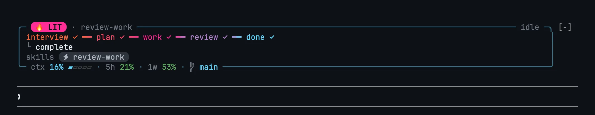</p>

카드는 Claude Code 2.1.287 이상의 터미널과 Claude 데스크톱 앱의 Code 탭에서 나옵니다. 앱도
같은 설정 파일을 읽기 때문에 설치 프로그램이 둘 다 준비해 둡니다. 설치한 뒤 앱에서 새 세션을
열면 됩니다. 앱은 카드의 글자를 고정폭이 아닌 글꼴로 그리기 때문에, 같은 줄과 움직임을 담은
그림 한 장으로 보여 줍니다.

기본으로 카드는 세션 내내 떠 있고, Claude가 일하는 동안 움직입니다. `/config`의 LitClaude 항목에
있는 세 가지 설정으로 이를 바꿀 수 있습니다.

- `band`를 `auto`로 두면 작업이 도는 동안에만 카드가 보입니다. 작업 사이에는 프롬프트를 깔끔하게
  두고 싶을 때 쓰세요. `off`는 카드를 숨깁니다.
- `motion`을 `subtle`로 두면 움직임이 잔잔해지고, `off`면 멈춥니다.
- `notify`를 `finish`로 두면 긴 작업 중에 자리를 비워도 됩니다. 작업이 끝나거나, 3분 넘게 걸린 LIT
  턴이 끝나면 터미널로 알림을 보냅니다. 직접 켜기 전까지는 꺼져 있습니다.

데스크톱 앱에는 이 설정을 바꾸는 화면이 없으니 터미널에서 바꾸세요.

```bash
npx @litfamily/litclaude@latest config             # 지금 설정 보기
npx @litfamily/litclaude@latest config band auto   # motion subtle, glyphs basic, notify finish도 같은 방식
```

[카드가 보여 주는 모든 것](./docs/hooks.md#the-lit-band-claude-code-mod)

## 친구 초대

LitFamily는 입소문으로 퍼집니다. 초대는 누가 LitClaude를 알려 줬는지 남기는 방법입니다. 알려 준
사람의 GitHub 아이디를 프롬프트에 한 번, 그것만 입력하세요.

```text
lit invite @octocat
```

LitClaude는 Claude 턴을 시작하지 않고 바로 답하고, 이름을 내 컴퓨터의 `~/.litclaude/invite.json`에
저장합니다. 그때부터 쉬고 있는 카드가 클럽 룩으로 바뀝니다. 테두리 전체가 금색에서 장밋빛을 지나
보라색으로 이어지고, 윗변을 따라 금빛이 천천히 지나갑니다. 오른쪽에는 금색 필에 담긴 `CLUB ✦`가,
아래쪽에는 `invited by @octocat` 칩이 작게 붙습니다. 어디로도 아무것도 보내지 않습니다.
친구에게 공을 돌리고 싶다면 [LitFamily Discussions](https://github.com/wjgoarxiv/litfamily/discussions)에
"invited by @octocat"이라고 남겨 주세요. LitFamily 페이지의 명예의 전당은 그 글을 보고 손으로
정리합니다.

처음 초대가 그대로 남습니다. 나중에 다른 아이디를 넣으면 기록하지 않고 그렇다고 알려 줍니다.
`lit invite`만 입력하면 내 친구에게 보낼 문장이 나옵니다. 터미널에서는
`npx @litfamily/litclaude@latest invite @octocat`이 같은 일을 하고, `config club off`로 원래 카드로
돌아갈 수 있습니다.

## 자동 핸드오프

세션이 길어지면 Claude의 컨텍스트 창이 차고, Claude Code가 대화를 압축할 때 작업의 세부 내용이
요약에서 빠질 수 있습니다. 자동 핸드오프를 켜 두면 아직 여유가 있을 때 Claude가 핸드오프 파일을
쓰고, 압축이 끝난 뒤 LitClaude가 그 파일을 다시 읽어 줍니다. 그래서 세션의 나머지는 내가 남긴
기록에서 이어집니다.

직접 켜고 비율을 정하기 전까지는 꺼져 있습니다. 프롬프트 전체로 `lit-handoff auto on 65`처럼
1부터 99 사이의 정수를 붙여 입력하면 LitClaude가 한 줄로 답하고 다른 작업은 시작하지 않습니다. 나중에 `status`로 지금 설정을 확인하고, `off`로
끄면 정해 둔 비율은 다음을 위해 남습니다.

<p align="center"><picture><source media="(prefers-color-scheme: dark)" srcset="./docs/assets/handoff/settings-dark.webp" />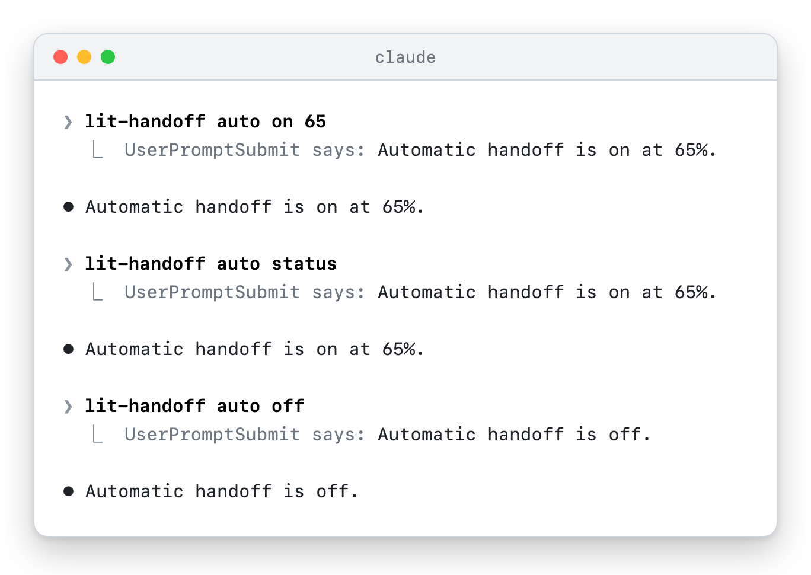</picture></p>

설정은 Claude Code를 시작한 프로젝트 폴더마다 따로 저장됩니다. 비율은 Claude Code가 스스로
압축하는 지점보다 낮게 고르세요. 압축이 먼저 일어나면 되살릴 핸드오프가 없습니다. 켜져 있는
동안 상태 줄에 `handoff@65%`가 보입니다.

턴이 끝날 때 컨텍스트가 정한 비율에 닿아 있으면, Stop 훅이 Claude에게 멈추기 전에
핸드오프를 쓰라고 합니다. Claude Code는 플러그인이 압축을 시작할 방법을 주지 않기 때문에,
Claude가 한 줄로 알려 주면 `/compact`는 직접 실행합니다. 압축이 끝나면 LitClaude가 방금 쓴
핸드오프를 대화에 다시 읽어 넣습니다.

<p align="center"><picture><source media="(prefers-color-scheme: dark)" srcset="./docs/assets/handoff/compact-dark.webp" />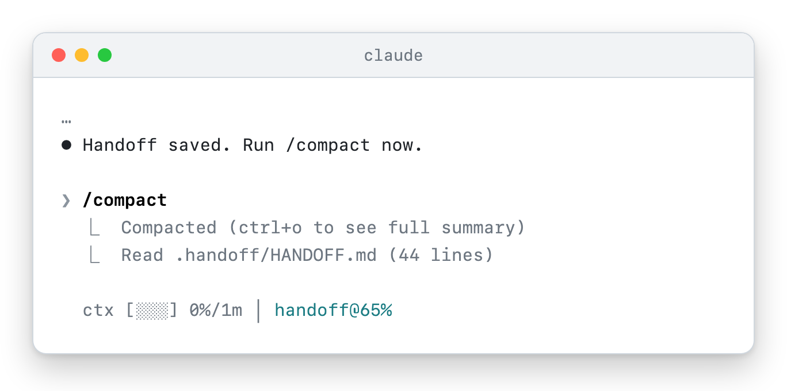</picture></p>

Claude Code를 시작하기 전에 셸에서 켤 수도 있습니다. 두 환경 변수가 저장된 설정보다 우선하고,
doctor가 지금 적용 중인 설정을 알려 줍니다.

<p align="center"><picture><source media="(prefers-color-scheme: dark)" srcset="./docs/assets/handoff/env-dark.webp" />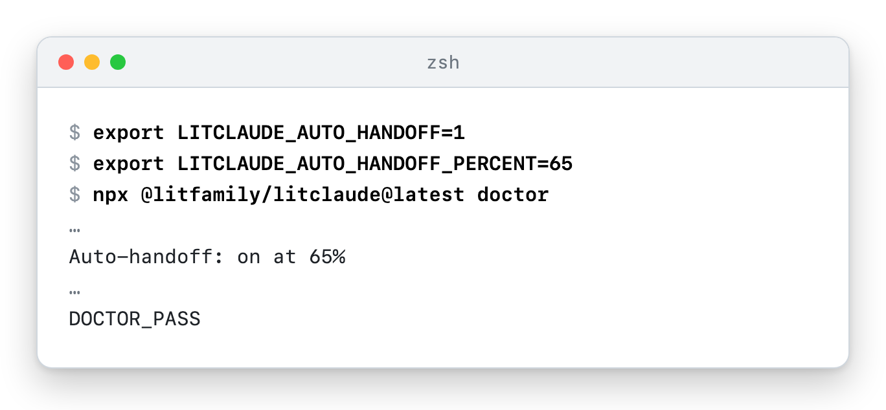</picture></p>

[자동 핸드오프가 단계별로 어떻게 돌아가는지](./docs/guide_ko-KR.md#자동-핸드오프)

## 무엇을 할 수 있나요

LitClaude에는 직접 시작하는 스킬 39개와 알아서 도는 스킬 3개, 슬래시 명령 20개, 에이전트
11개가 들어 있습니다. 평소에는 그중 몇 개만 쓰게 됩니다.

### 작업 루프

어떤 요청에든 `lit`을 붙이세요. Claude가 목표를 고정하고, 실패하는 테스트를 먼저 쓰고, 그
테스트를 통과하는 가장 작은 변경을 한 뒤 실제 결과를 확인하고 프로젝트에 기록을 남깁니다.

```text
src/dates.js의 날짜 파싱 버그를 고치고, 고치기 전에는 실패하는 테스트도 추가해줘 lit
```

### 계획 먼저, 그다음 구현

큰 변경이라면 `lit plan`이 번호 붙은 작업과 작업마다 예/아니오로 답할 수 있는 확인 항목을
담은 계획을 쓰고, 아직 아무것도 고치지 않습니다. 계획을 읽어 보고 괜찮으면 계획 파일과 함께
`/litclaude:start-work`를 입력하세요. 이 명령을 입력하는 것 자체가 승인이라서, 목표 줄을 먼저 붙여
넣을 필요가 없습니다. 그러면 작업을 하나씩 실행하고, 확인 항목을 통과한 작업에만 체크 표시를
합니다. 열린 계획이 하나뿐이면 명령만 입력해도 됩니다.

```text
lit plan 보고서 페이지에 CSV 내보내기를 테스트와 함께 추가해줘
/litclaude:start-work <작성된 계획 파일>
```

### 병합 전에 한 번 더 보기

`lit review`는 있는 것에 맞춰 모드를 고릅니다. 아직 시작하지 않은 계획은 계획 검토, 끝난 변경은 작업
검토입니다. 작업 검토는 같은 변경과 그 근거를 서로 독립된 다섯 갈래의 검토로 읽습니다. 찾은 문제를
먼저 보고하고, 고치는 일은 따로 합니다. `lit review plan`이나 `lit review work`로 모드를 직접 고를
수 있습니다.

```text
lit review 이 브랜치의 변경 사항
```

### 출처가 남는 조사

`lit research`는 질문을 나누어 여러 검색을 동시에 공개 자료에 보내고, 답에서 사실과 불확실한
부분을 구분합니다. 로그인이나 유료 벽을 만나면 멈춥니다.

```text
lit research 작은 웹 앱에서 SQLite 쓰기 속도에 가장 큰 영향을 주는 설정은?
```

### 발표자료, 보고서, 한국어 문장 다듬기

발표자료나 보고서를 부탁하면서 끝에 `lit`을 붙이면, 네이티브 차트가 들어간 편집 가능한
`.pptx`나 서식을 갖춘 `.docx`가 나옵니다. 글꼴은 Pretendard이고, 렌더링한 페이지를 한 장씩
확인한 뒤 넘겨 줍니다. `lit-humanizer`는 딱딱한 한국어나 영어 문장을 사실은 그대로 두고 다시
씁니다.

무언가를 만드는 스킬은 기본으로 꽉 찬 결과를 냅니다. 발표자료, 다이어그램, 장치도, 그림,
화면, 영상 모두 여러 강조색과 눈에 띄는 디테일 하나를 갖춘 촘촘한 모습으로 나옵니다. 더 차분한
결과가 좋다면 요청에 "차분하게", "미니멀하게"처럼 적으면 덜어 냅니다.

```text
팀 워크숍 발표자료 만들어줘 lit
새 온보딩 흐름에 대한 두 쪽짜리 프로젝트 제안서 써줘 lit
lit-humanizer docs/intro.md
```

### P&ID, 실험 장치도, 컷어웨이

`lit-schematic`은 실제 장비를 그립니다. ISA-5.1 태그와 배관 경로, 범례, 표제란을 갖춘 P&ID,
논문에 넣을 두 패널짜리 실험 장치 그림, 용기 내부를 보여 주는 아이소메트릭 컷어웨이를 만들
수 있습니다. 그림마다 겹침, 심볼을 지나는 선, 작은 글자를 QA 게이트로 검사하고, SVG와 PDF,
600 dpi PNG로 내보낸 뒤 Claude가 이미지를 직접 열어 확인하고 나서 보고합니다.

```text
lit 고압 하이드레이트 반응기 루프 P&ID 그려줘
lit draw a two-panel journal figure of the experimental setup
```

### 읽고 탐난 기법을 내 스킬로

스레드나 글, 저장소를 보다가 내 스킬에는 없는 요령을 발견했을 때, 남의 문장을 베끼지 않고
그 노하우만 가져오고 싶다면 `lit hijack`을 쓰세요. 자료와 대상을 주면 자료마다 어디서 왔는지
기록하고, 라이선스를 확인해 쓸 수 없는 것은 빼고, 내 스킬에 무엇이 모자라는지 파일과 줄 번호를
근거로 찾습니다. 그다음 자기 말로 사양을 쓰고, `lit plan`과 start-work로 구현한 뒤, 같은
프롬프트를 이전 버전과 새 버전에 돌려 변화를 증명합니다. 보고서에는 무엇을 가져왔고 무엇을
왜 두고 왔는지가 남습니다.

```text
lit hijack https://x.com/… 그리고 docs/paper.pdf를 내 lit-pptx 스킬에 가져와줘
```

### 다음 세션으로 이어가기

`handoff`는 목표, 확인한 것, 남은 일을 담은 이어가기 파일을 씁니다. 자동 핸드오프를 켜면 긴
세션을 Claude Code가 압축하기 전에 이 파일을 대신 써 둡니다. `lit-handoff auto on 60`처럼 직접
비율을 정하기 전까지는 꺼져 있습니다.

### 어디까지 했더라?

창 여러 개와 워크트리, 끼어든 일들로 하루를 보내고 나면 `lit adhd`(별칭 `lit rewind`)를 입력하세요.
이 저장소의 최근 Claude Code 세션을 모두 읽고 한 화면으로 정리해 줍니다. 세션마다 무엇을 부탁받아
무엇을 했고 나를 기다리는지, 로드맵과 열린 계획이 어디까지 왔는지를 진행 게이지로 보여 주고,
멈춰 둔 작업과 다음에 할 일 하나를 알려 줍니다. 읽기만 하고 아무것도 바꾸지 않습니다. 제안한 일이
마음에 들면 같은 세션에서 30분 안에 `go`라고 입력하세요(`ㄱㄱ`나 `진행`도 됩니다). Claude가 그 일을
이어서 합니다.

```text
lit adhd
go
```

[전체 입력 경로](./docs/guide_ko-KR.md#무엇을-입력하나요)와 [그림으로 보는 전체 스킬](./docs/skills_ko-KR.md)

## 작동 방식

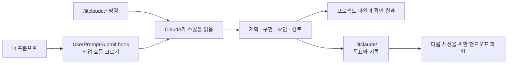

설치 프로그램은 플러그인을 Claude Code의 플러그인 폴더에 복사하고 등록합니다. 평범한 프롬프트를
보내면 hook이 그것을 읽고 어떤 작업 흐름이 맞는지 짧게 적어 Claude에게 넘기고, 슬래시 명령은
곧장 해당 스킬로 갑니다. 다른 hook은 세션을 시작할 때 프로젝트 규칙을 읽어 들이고, 파일을 고친
뒤에는 무엇을 확인할지 Claude에게 일러 줍니다. 목표가 걸린 작업의 기록은 프로젝트의 `.litclaude/`
폴더에 남습니다. 이 폴더에는 `*` 한 줄짜리 `.gitignore`가 들어 있어서, 사용자의 ignore 파일을
바꾸지 않고도 Git이 이 폴더를 건너뜁니다. 세션과 세션 사이에 따로 돌아가는 것은 없습니다.
[hook 자세히 보기](./docs/hooks.md)와 [네트워크로 오가는 것](./docs/privacy.md)

## 요구 사항, 업데이트, 제거

Node.js와 npm, Claude Code가 있으면 됩니다. 발표자료와 문서 스킬은 처음 쓸 때 버전을 고정한
도구를 `~/.cache/litclaude/office-runtime`에 설치합니다.

npm으로 설치했다면 관리는 명령 세 개로 합니다.

```bash
npx @litfamily/litclaude@latest doctor      # 플러그인, 상태 줄, 권한 모드 점검
npx @litfamily/litclaude@latest update      # 최신 릴리스를 지금 설치
npx @litfamily/litclaude@latest uninstall   # LitClaude가 설치한 것 제거
```

문제가 없으면 `doctor`는 `DOCTOR_PASS`로 끝납니다. `update`를 직접 입력할 일은 많지 않습니다. 새 Claude Code 세션은 하루 한 번까지 백그라운드에서 npm의 새 버전을 확인하고, 이후 세션이 작업을
시작하기 전에 설치합니다. `uninstall`은 LitClaude가 관리하는 플러그인, 상태 줄, 권한, 로컬 상태
항목만 지웁니다. 직접 수정한 설치라면 그대로 두고 [소유권 충돌 안내](./docs/migration.md#ownership-conflicts)를
알려 줍니다.

마켓플레이스로 추가한 플러그인에는 LitClaude 상태 줄이 없고, 업데이트와 제거는 Claude Code의
`/plugin` 메뉴에서 합니다.

## 더 알아보기

- [안내서](./docs/guide_ko-KR.md): 설치 옵션, 화면에 나오는 모습, 홍보 영상, 전체 입력 경로, 자동
  핸드오프, 발표자료와 문서, 상태 줄, 안전, Claude Code 연결 구조를 자세히 다룹니다.
- [전체 스킬](./docs/skills_ko-KR.md): 스킬 39개와 자동 점검을 한 줄씩 그림과 함께 보여 줍니다.
- [hook](./docs/hooks.md), [에이전트](./docs/agents.md), [개인정보와 네트워크](./docs/privacy.md),
  [이전과 소유권 충돌](./docs/migration.md),
  [패키지 이름 이전과 마켓플레이스 선택](./docs/migration.md#scoped-npm-migration), [Claude Code `/goal` 지원 범위](./docs/native-goal-surface.md),
  [작업 흐름 호환성 점검](./docs/workflow-compatibility-audit.md)
- [개발](./docs/development_ko-KR.md): checkout 검증 명령, 플러그인 로컬 로드, 프로젝트 지도
- [변경 이력](./CHANGELOG.md)과 [English README](./README.md)
- [LitFamily](https://github.com/wjgoarxiv/litfamily): 다른 코딩 에이전트를 위한 같은 방식의 도구

## LITFAMILY

표지의 아머드 로봇 일곱 대는 LitFamily 제품 일곱 개를 뜻합니다. 각 제품은 자기 호스트에서 따로
동작하니, 쓰는 것 하나만 설치하면 됩니다. 표지는 브랜드 모션이고,
[Ignition 영상](./docs/assets/readme/ignition-film.mp4)도 같은 분위기의 짧은 브랜드 영상입니다.
실제 Claude Code 세션은 이 페이지 위쪽의 데모 영상에서 볼 수 있습니다.

<p align="center"></p>

<details>
<summary>ASCII 로고 복사</summary>

```text
                             ▄▄▄▄
                   ▗███▌   ▗██████▖
 ▗▄▄▄▄▄          ▗▟████▌   ▝██████▘
 ▐█████        ▗▟██████▌    ▝▀▜█▀▘
 ▐█████      ▗▟███████▄▄▄▄▄▄▄▄▄▄▄▄▄▄▄▄▄▄▄▄
 ▐█████    ▗▟█████████████████████████ ▐█▀
 ▐█████    ████████████████████████████▀
 ▐█████    ██▛▘   ▄ ▄▄▄▄▖▄▄▄▄▄▄▄▄▄▄▄▄▄▖
 ▐█████    ▀    ▄██ ████▌█████████████▌
 ▐█████       ▄████ ████▌█████████████▌
 ▐█████     ▄█████▛                                 claude
 ▐█████  ▗▟█████▀▘       ▄▄▄▄▄     ▗▖               ──────────────
 ▐█████ ▐█████▀          █████     ▐▛▀              hermes · codex
 ▐█████ ▐███▀            █████                      opencode · grok
 ▐█████ ▐█▀              █████                      muse · gravity
 ▐█████ ▝                █████
 ▐█████▄▄▄▄▄▄▄▖          █████
 ▐███████████▛           █████
 ▐██████████▀            █████

```

</details>

같은 프로젝트를 두 번 설명하는 수고를 LitClaude가 덜어 줬다면, GitHub 스타 하나가 다른 Claude Code
사용자가 이 프로젝트를 찾는 데 도움이 됩니다.

기여하려면 [기여 안내](./CONTRIBUTING.md)부터 읽어 주세요. 질문은 [지원](./SUPPORT.md)으로,
보안 문제는 [보안](./SECURITY.md)에 적힌 방법으로 알려 주시고, [행동 강령](./CODE_OF_CONDUCT.md)은
모든 참여자에게 적용됩니다. LitClaude는 [MIT 라이선스](./LICENSE)로 배포합니다. LitClaude와
LitFamily라는 이름과 로고는 [상표 정책](./TRADEMARK.md)을 따로 따릅니다. 포크는 자기 이름을 달면
얼마든지 환영합니다.
