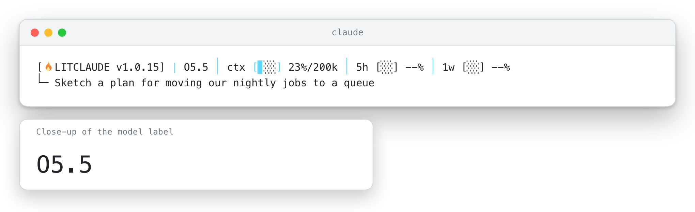
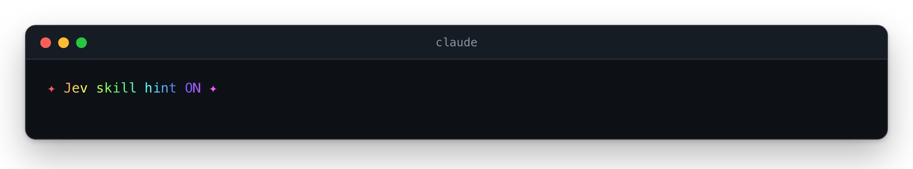
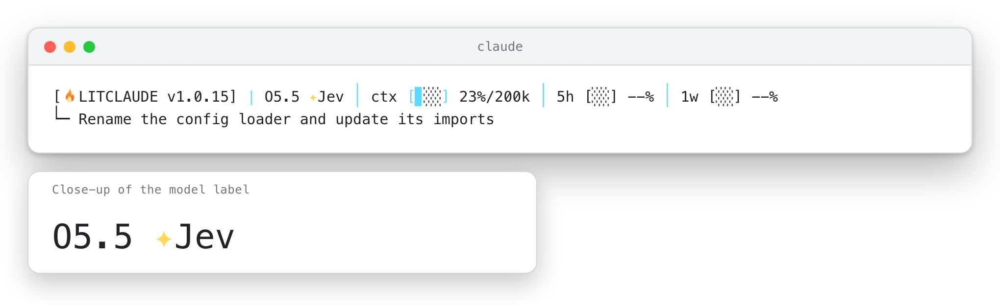
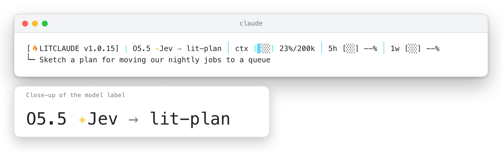
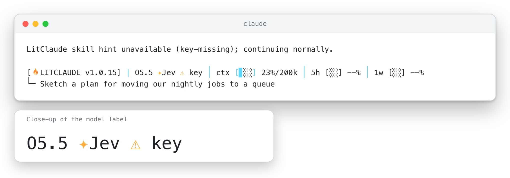

# Jev skill hint (optional)

[README](../README.md) · [Guide](./guide.md) · [한국어](./jev_ko-KR.md)

LitClaude has 35 skills, and Jev, a choice model hosted by TypeSafe, can suggest which one
fits a prompt. When Jev names a skill, the `UserPromptSubmit` hook adds one line with that
name for Claude to consider. It is only a suggestion: Claude still decides whether to load
the skill, and the line cannot grant a permission or start a tool.

Jev is off by default. To try it, set both variables in the environment that launches
Claude Code:

```bash
export LITCLAUDE_JEV=1
export TYPESAFE_API_KEY=<your own TypeSafe key>
```

Turning it on sends your prompts off your machine, so here is exactly what goes out. Each
eligible prompt goes to TypeSafe (typesafe.ai), cut to 2,000 characters, with home paths,
e-mail addresses and token-shaped strings redacted. The rest of the prompt goes as you
wrote it, including a hostname, a customer name or a password that isn't written as
`password=…`. Slash commands, prompts the `lit` router already handled and prompts that
name a skill stay on your machine, and so does everything else from the session: files,
tool output and history.

Two more things before you switch it on. The key lives in the shell that starts Claude
Code, where the agent's own tools can read it as well, so give this feature a key of its
own with a low spend limit. And TypeSafe bills your account for every request, at about
$0.04 per million input tokens. Each request waits at most 1.5 seconds. If one fails, the
turn carries on as usual and you see one short note, the first time it happens in a
session.

To check that it is on, run `litclaude doctor`. It prints `Jev skill hint: off`, `on`, or
`flag on but TYPESAFE_API_KEY missing`. To turn Jev off, unset `LITCLAUDE_JEV` or set it to
anything other than `1`. `docs/hooks.md` covers the tuning variables and the local debug
trace.

## What you will see

Jev shows itself in three places: the HUD status line, one line on the first prompt of a
session, and `litclaude doctor`. The pictures below are sample output from LitClaude's own
status line and prompt hook, run on a small demo project with a placeholder key. The
network call was replaced by the repository's test stand-in, so nothing went to TypeSafe.
The prompts and the skill name are examples. Each picture follows your page theme; on a
light terminal the word Jev keeps the default colour and only the marks are coloured.

With Jev off, the model name stands alone on the status line. This is what you see until
you set both variables.

<p align="center"><picture><source media="(prefers-color-scheme: dark)" srcset="./assets/jev/jev-status-off-dark.webp" /></picture></p>

*Sample output, rendered from LitClaude's own status line.*

Turn Jev on, and the first prompt of each session shows one line in rainbow colours (plain
text when `NO_COLOR` is set). It reminds you that eligible prompts in this session go to
TypeSafe.

<p align="center"></p>

*Sample output, rendered from LitClaude's own prompt hook.*

From then on, `✦Jev` sits right after the model name, and the word shimmers when your
terminal allows colour. When Jev finds no skill that fits well enough, this badge is the
only change and the turn runs as usual. The enlarged label under each status-line picture keeps
the model name readable on a small screen.

<p align="center"><picture><source media="(prefers-color-scheme: dark)" srcset="./assets/jev/jev-status-quiet-dark.webp" /></picture></p>

*Sample output, rendered from LitClaude's own status line.*

When Jev names a skill, the name follows an arrow for that turn, and Claude gets one line
suggesting it. Claude decides whether to load the skill. The name here is an example.

<p align="center"><picture><source media="(prefers-color-scheme: dark)" srcset="./assets/jev/jev-status-hint-dark.webp" /></picture></p>

*Sample output, rendered from LitClaude's own status line after a hinted turn.*

If the flag is on and the key is empty, the badge turns amber and reads `⚠ key`, and the
first eligible prompt shows one short note. Nothing goes to TypeSafe, and your prompts reach Claude
as usual. Set the key and the badge returns to `✦Jev`; unset the flag and it disappears.

<p align="center"><picture><source media="(prefers-color-scheme: dark)" srcset="./assets/jev/jev-status-key-dark.webp" /></picture></p>

*Sample output, rendered from LitClaude's own prompt hook and status line.*
