# LitClaude skills

[README](../README.md) · [Guide](./guide.md) · [한국어](./skills_ko-KR.md)

LitClaude's core holds 30 skills you start yourself and three that run on their own. They ship in the
plugin and need nothing else. Ten more skills are LitFamily extensions: they live on the wjgoarxiv-skills
marketplace in six small plugins, and LitClaude keeps a same-name stub for each. With the extension
installed, the stub hands the request over; without it, the stub gives you the install line. Each row shows
a picture of what the skill gives you, the prompt or command that starts it, and the result.

## Core skills

One row per skill: what it looks like, the route that starts it, and what you get.

<table>
<tr><th>What it looks like</th><th>Skill</th><th>What you get</th></tr>
<tr>
<td>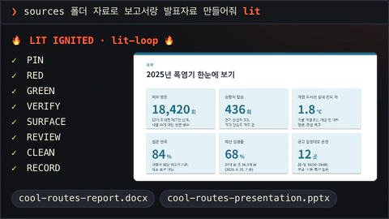</td>
<td><code>lit-loop</code><br /><sub><code>lit</code></sub></td>
<td>Add <code>lit</code> to any request. Claude pins the goal, writes a failing test first, checks the real surface and leaves a record.</td>
</tr>
<tr>
<td>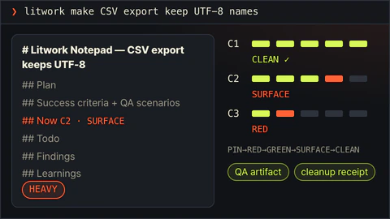</td>
<td><code>litwork</code><br /><sub><code>litwork &lt;task&gt;</code></sub></td>
<td>Ship with proof. A notepad tracks every criterion from failing test to cleanup.</td>
</tr>
<tr>
<td>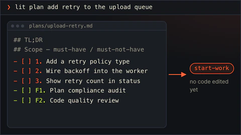</td>
<td><code>lit-plan</code><br /><sub><code>lit plan &lt;what&gt;</code></sub></td>
<td>A plan file with numbered task rows that <code>start-work</code> can execute. Nothing is edited yet.</td>
</tr>
<tr>
<td>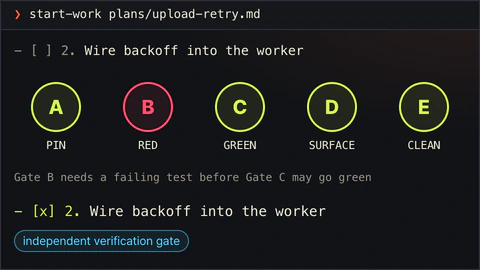</td>
<td><code>start-work</code><br /><sub><code>start-work &lt;plan&gt;</code></sub></td>
<td>Runs a plan row by row. A box is checked only after all five gates pass.</td>
</tr>
<tr>
<td>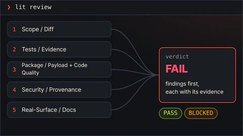</td>
<td><code>review-work</code><br /><sub><code>lit review &lt;scope&gt;</code></sub></td>
<td>Plan review checks a plan before work starts; work review sends five independent lanes over the finished change. Findings come first.</td>
</tr>
<tr>
<td>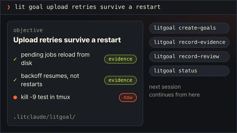</td>
<td><code>litgoal</code><br /><sub><code>lit goal &lt;outcome&gt;</code></sub></td>
<td>Sets and keeps the finish line: one objective with checkable criteria, kept on disk. <code>lit-loop</code> and <code>start-work</code> run toward it.</td>
</tr>
<tr>
<td>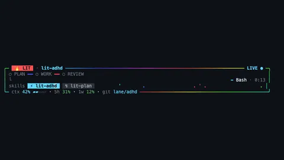</td>
<td><code>lit-adhd</code><br /><sub><code>lit adhd</code> · <code>lit-rewind</code></sub></td>
<td>A six-line card in Korean (<code>--en</code> for English): what changed since you last looked and the one thing to do now. <code>lit adhd detail</code> opens the full board; <code>lit adhd recap</code> is the session recap that lit-recap used to give.</td>
</tr>
<tr>
<td>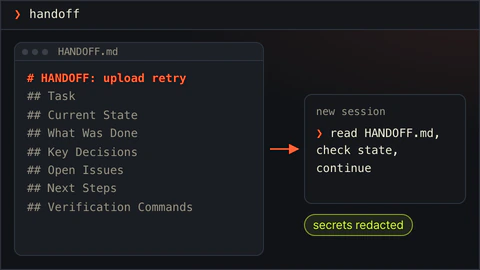</td>
<td><code>lit-handoff</code><br /><sub><code>handoff</code></sub></td>
<td>Type <code>handoff</code> to get a continuation file the next session can read and resume from.</td>
</tr>
<tr>
<td>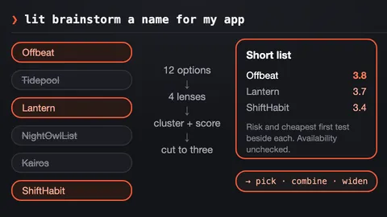</td>
<td><code>lit-brainstorm</code><br /><sub><code>lit brainstorm &lt;topic&gt;</code></sub></td>
<td>Many different options, scored against your criteria and cut to a short list you choose from. The pick then goes to deep-interview or lit-plan.</td>
</tr>
<tr>
<td>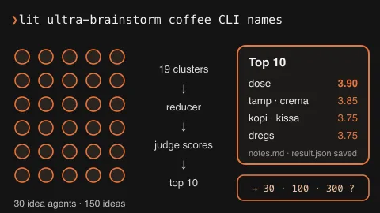</td>
<td><code>ultra-brainstorm</code><br /><sub><code>lit ultra-brainstorm &lt;topic&gt;</code></sub></td>
<td>Asks once how big to go (30, 100 or 300 idea agents, with the token cost). A Workflow then gathers the ideas, groups them, and a judge scores a top 10 for you to pick from, combine or widen.</td>
</tr>
<tr>
<td>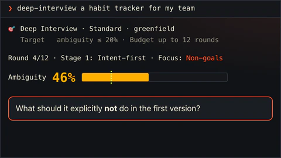</td>
<td><code>deep-interview</code><br /><sub><code>deep-interview &lt;idea&gt;</code></sub></td>
<td>One question at a time until the idea is clear enough to build. A meter shows how much is still vague.</td>
</tr>
<tr>
<td>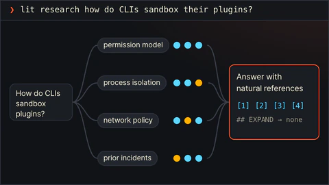</td>
<td><code>litresearch</code><br /><sub><code>lit research &lt;question&gt;</code> · <code>lit search</code></sub></td>
<td>Splits a research question, sends parallel searchers and follows every lead before answering with sources.</td>
</tr>
<tr>
<td>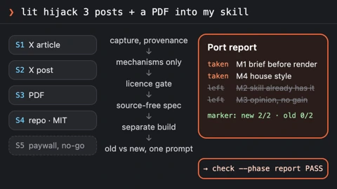</td>
<td><code>lit-hijack</code><br /><sub><code>lit hijack &lt;sources&gt;</code></sub></td>
<td>Ports a technique from someone else's posts, repos or PDFs into your own skill: sources on record, licence checked, built from a spec without their wording, proven before and after.</td>
</tr>
<tr>
<td>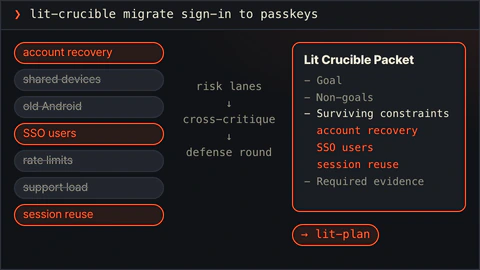</td>
<td><code>lit-crucible</code><br /><sub><code>lit-crucible &lt;brief&gt;</code></sub></td>
<td>Pressure-tests a brief before planning. Only the risks that survive critique reach the plan.</td>
</tr>
<tr>
<td>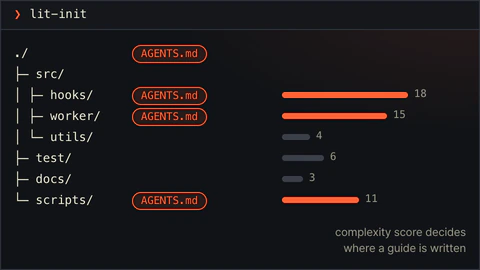</td>
<td><code>lit-init</code><br /><sub><code>lit-init</code></sub></td>
<td>Maps a repository into a root AGENTS.md and short guides for the folders that need one.</td>
</tr>
<tr>
<td>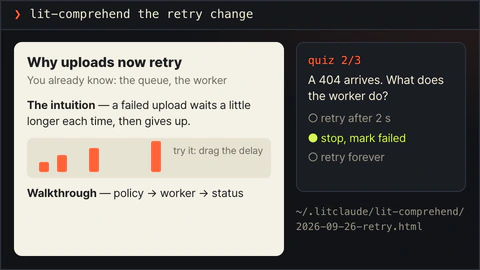</td>
<td><code>lit-comprehend</code><br /><sub><code>lit-comprehend &lt;target&gt;</code></sub></td>
<td>An explainer page for agent-written work: intuition first, then the walkthrough, then a short quiz.</td>
</tr>
<tr>
<td>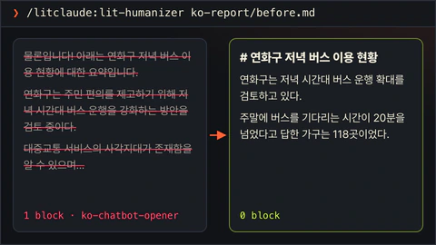</td>
<td><code>lit-humanizer</code><br /><sub><code>lit-humanizer &lt;text&gt;</code></sub></td>
<td>Rewrites stiff model prose in English or Korean. Facts and hedges stay; filler goes.</td>
</tr>
<tr>
<td>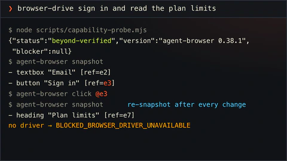</td>
<td><code>browser-drive</code><br /><sub><code>browser-drive &lt;task&gt;</code></sub></td>
<td>Drives a real page after verifying the browser driver. If there is none, it says so.</td>
</tr>
<tr>
<td>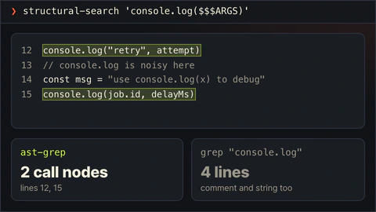</td>
<td><code>structural-search</code><br /><sub><code>structural-search &lt;pattern&gt;</code></sub></td>
<td>Finds code by its syntax shape, not its text, and previews rewrites before applying them.</td>
</tr>
<tr>
<td>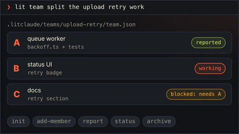</td>
<td><code>lit-team</code><br /><sub><code>lit team &lt;goal&gt;</code></sub></td>
<td>Type <code>lit team</code> with a goal and this session becomes the orchestrator. It splits the work, launches the members, watches them, merges and re-checks the result, then tells you what happened.</td>
</tr>
<tr>
<td>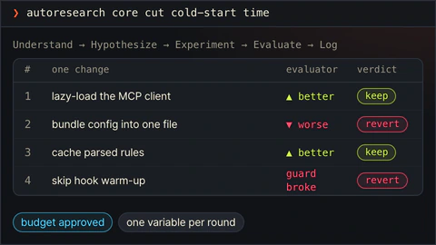</td>
<td><code>autoresearch</code><br /><sub><code>autoresearch &lt;mode&gt;</code></sub></td>
<td>An approved, budgeted experiment loop. Each round changes one thing and keeps or reverts it.</td>
</tr>
<tr>
<td>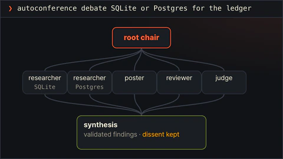</td>
<td><code>autoconference</code><br /><sub><code>autoconference &lt;mode&gt;</code></sub></td>
<td>A budgeted research conference: separate researchers, reviewers, and a synthesis that keeps disagreement.</td>
</tr>
<tr>
<td>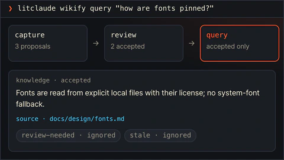</td>
<td><code>wikify</code><br /><sub><code>litclaude wikify capture|save|review|query|config</code></sub></td>
<td>Keeps reviewed project knowledge on disk and answers later questions from it, with sources.</td>
</tr>
<tr>
<td>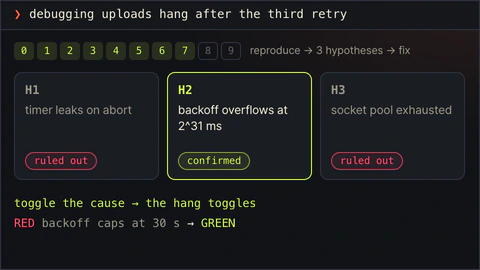</td>
<td><code>debugging</code><br /><sub><code>debugging &lt;symptom&gt;</code></sub></td>
<td>Reproduces the bug, tests at least three explanations, and fixes only the confirmed cause.</td>
</tr>
<tr>
<td>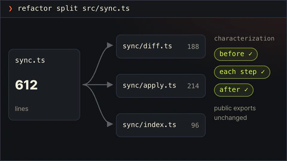</td>
<td><code>refactor</code><br /><sub><code>refactor &lt;target&gt;</code></sub></td>
<td>Restructures code while tests pin its behavior before and after every step.</td>
</tr>
<tr>
<td>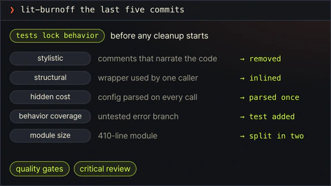</td>
<td><code>lit-burnoff</code><br /><sub><code>lit-burnoff &lt;scope&gt;</code></sub></td>
<td>Cleans AI-written bloat out of a change set after tests lock what it does.</td>
</tr>
<tr>
<td>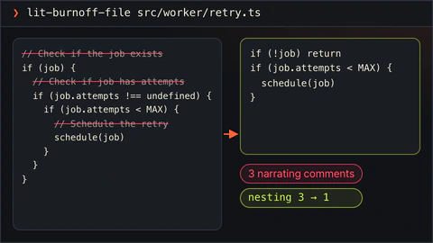</td>
<td><code>lit-burnoff-file</code><br /><sub><code>lit-burnoff-file &lt;path&gt;</code></sub></td>
<td>The same cleanup for one file: fewer narrating comments, less defensive noise, flatter code.</td>
</tr>
<tr>
<td>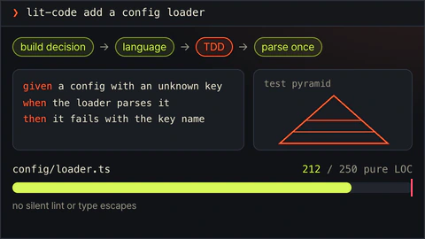</td>
<td><code>lit-code</code><br /><sub><code>lit-code &lt;task&gt;</code></sub></td>
<td>Strict implementation rules: tests first, typed boundaries, small files.</td>
</tr>
<tr>
<td>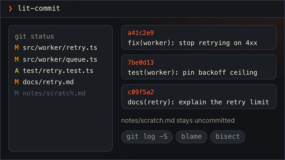</td>
<td><code>lit-commit</code><br /><sub><code>lit-commit</code></sub></td>
<td>Splits your changes into atomic commits in the repo's own style and leaves unrelated work alone.</td>
</tr>
<tr>
<td>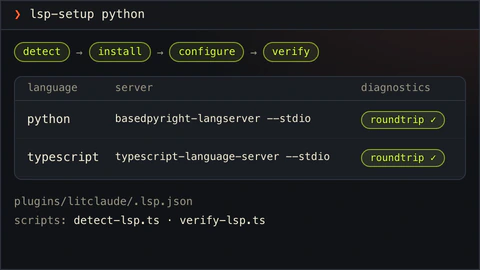</td>
<td><code>lsp-setup</code><br /><sub><code>lsp-setup &lt;language&gt;</code></sub></td>
<td>Sets up a language server for your language and proves diagnostics really work.</td>
</tr>
<tr>
<td>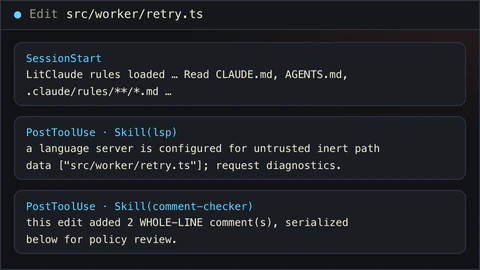</td>
<td><code>rules</code> · <code>lsp</code> · <code>comment-checker</code><br /><sub>runs on its own</sub></td>
<td>Runs on its own: loads your project rules, asks for diagnostics after edits, and reviews new comments.</td>
</tr>
</table>

## Extensions

The extension skills live in six plugins you install beside LitClaude, one at a time, only for the work
you do. In your own terminal, `npx @litfamily/litclaude extensions list` shows all six and whether each
is installed. The install line under each plugin prints its install plan, stops if a skill of your own has
the same name, and runs the plan when you add `--yes`.

### decks

Editable PowerPoint decks.

```bash
npx @litfamily/litclaude extensions install decks
```

<table>
<tr><th>What it looks like</th><th>Skill</th><th>What you get</th></tr>
<tr>
<td>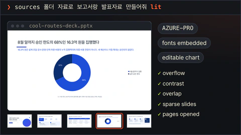</td>
<td><code>lit-pptx</code><br /><sub><code>/litclaude:lit-pptx &lt;request&gt;</code> · <code>decks:lit-pptx</code></sub></td>
<td>In the <code>decks</code> extension. Ask for slides with <code>lit</code> and get an editable PowerPoint deck with native charts and embedded fonts. Each slide passes a layout gate and is checked as rendered.</td>
</tr>
</table>

### documents

Styled Word documents.

```bash
npx @litfamily/litclaude extensions install documents
```

<table>
<tr><th>What it looks like</th><th>Skill</th><th>What you get</th></tr>
<tr>
<td>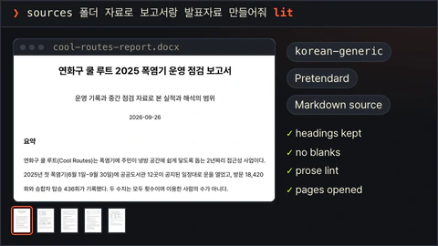</td>
<td><code>lit-docx</code><br /><sub><code>/litclaude:lit-docx &lt;request&gt;</code> · <code>documents:lit-docx</code></sub></td>
<td>In the <code>documents</code> extension. Ask for a report with <code>lit</code> and get a styled Word file with its Markdown source. Korean text is set in Pretendard, and the pages are rendered and read before delivery.</td>
</tr>
</table>

### sheets

Excel workbooks with live formulas.

```bash
npx @litfamily/litclaude extensions install sheets
```

<table>
<tr><th>What it looks like</th><th>Skill</th><th>What you get</th></tr>
<tr>
<td>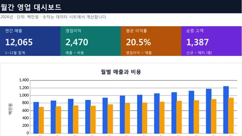</td>
<td><code>lit-xlsx</code><br /><sub><code>/litclaude:lit-xlsx &lt;request&gt;</code> · <code>sheets:lit-xlsx</code></sub></td>
<td>In the <code>sheets</code> extension. Ask for a budget, a model or a dashboard with <code>lit</code> and get an Excel file whose numbers are live formulas. LibreOffice recalculates it, an audit looks for formula errors, and every sheet is rendered and read before delivery.</td>
</tr>
</table>

### figures

Diagrams, physical schematics and journal figures.

```bash
npx @litfamily/litclaude extensions install figures
```

<table>
<tr><th>What it looks like</th><th>Skill</th><th>What you get</th></tr>
<tr>
<td>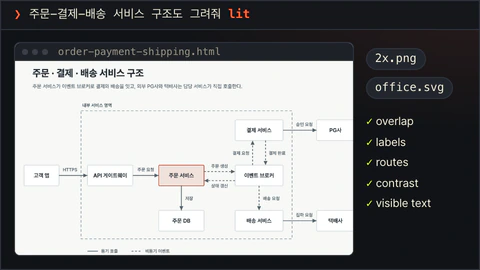</td>
<td><code>lit-diagram-drawer</code><br /><sub><code>/litclaude:lit-diagram-drawer &lt;brief&gt;</code> · <code>figures:lit-diagram-drawer</code></sub></td>
<td>In the <code>figures</code> extension. A checked, editable diagram for slides and documents, with PNG and Office-safe SVG exports.</td>
</tr>
<tr>
<td>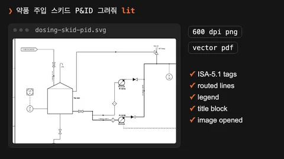</td>
<td><code>lit-schematic</code><br /><sub><code>/litclaude:lit-schematic &lt;brief&gt;</code> · <code>figures:lit-schematic</code></sub></td>
<td>In the <code>figures</code> extension. A P&amp;ID, apparatus figure or isometric cutaway of real equipment, checked by a QA gate and exported as SVG, PDF and 600 dpi PNG.</td>
</tr>
<tr>
<td>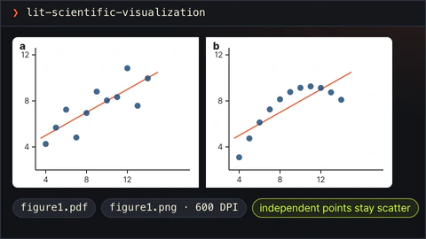</td>
<td><code>lit-scientific-visualization</code><br /><sub><code>lit-scientific-visualization</code> · <code>figures:lit-scientific-visualization</code></sub></td>
<td>In the <code>figures</code> extension. A journal-sized figure with vector and 600 DPI exports. The chart type follows the data.</td>
</tr>
</table>

### design

Building web interfaces and checking them on a real screen.

```bash
npx @litfamily/litclaude extensions install design
```

<table>
<tr><th>What it looks like</th><th>Skill</th><th>What you get</th></tr>
<tr>
<td>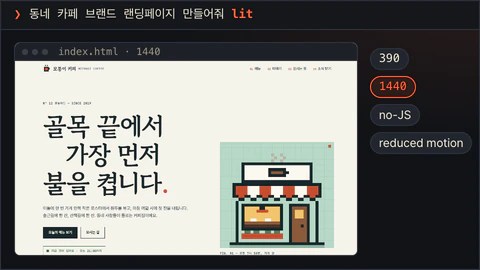</td>
<td><code>frontend-ui-ux</code><br /><sub><code>frontend-ui-ux build &lt;target&gt;</code> · <code>design:frontend-ui-ux</code></sub></td>
<td>In the <code>design</code> extension. Builds a working interface, then a measured probe renders it in seven views: 320, 390, 768 and 1440 px, dark, reduced motion and 200% zoom.</td>
</tr>
<tr>
<td>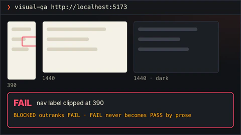</td>
<td><code>visual-qa</code><br /><sub><code>visual-qa &lt;target&gt;</code> · <code>design:visual-qa</code></sub></td>
<td>In the <code>design</code> extension. Checks a real screen at each viewport and returns an honest verdict, or names exactly what blocked it.</td>
</tr>
</table>

### video-covers

README covers and short films.

```bash
npx @litfamily/litclaude extensions install video-covers
```

<table>
<tr><th>What it looks like</th><th>Skill</th><th>What you get</th></tr>
<tr>
<td>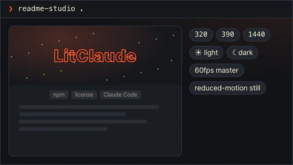</td>
<td><code>readme-studio</code><br /><sub><code>readme-studio &lt;scope&gt;</code> · <code>video-covers:readme-studio</code></sub></td>
<td>In the <code>video-covers</code> extension. A factual README with a moving cover, checked at phone and desktop widths in light and dark.</td>
</tr>
<tr>
<td>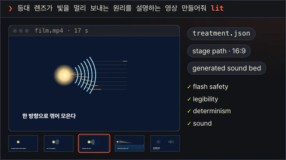</td>
<td><code>lit-typographic-motion</code><br /><sub><code>/litclaude:lit-typographic-motion &lt;request&gt;</code> · <code>video-covers:lit-typographic-motion</code></sub></td>
<td>In the <code>video-covers</code> extension. Ask for a video with <code>lit</code>. It picks one of four house styles by fixed rules, shows a storyboard before the full render, draws the scenes or sets the words in motion, adds a sound bed, and checks flashes, legibility, layout and sound before handing over the film.</td>
</tr>
</table>

To install by hand, run these two lines, then type `/reload-plugins` once in Claude Code:

```bash
claude plugin marketplace add wjgoarxiv/wjgoarxiv-skills
claude plugin install design@wjgoarxiv-skills
```

The frontend-ui-ux stub keeps the interface probe, so the lit workflows still check the web pages they build
when the `design` extension is missing.
