# LitClaude skills

[README](../README.md) · [Guide](./guide.md) · [한국어](./skills_ko-KR.md)

LitClaude ships 35 skills you start yourself and three that run on their own. Each row shows
a picture of what the skill gives you, the prompt or command that starts it, and the result.

## Skills at a glance

One row per skill: what it looks like, the route that starts it, and what you get.

<table>
<tr><th>What it looks like</th><th>Skill</th><th>What you get</th></tr>
<tr>
<td>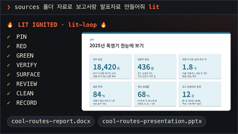</td>
<td><code>lit-loop</code> <code>lit</code></td>
<td>Add <code>lit</code> to any request. Claude pins the goal, writes a failing test first, checks the real surface and leaves a record.</td>
</tr>
<tr>
<td>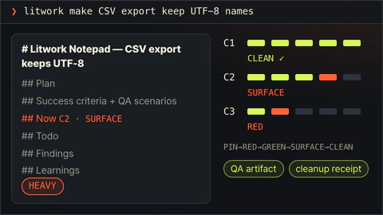</td>
<td><code>litwork</code> <code>litwork &lt;task&gt;</code></td>
<td>Ship with proof. A notepad tracks every criterion from failing test to cleanup.</td>
</tr>
<tr>
<td>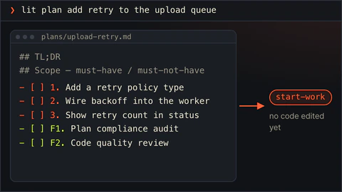</td>
<td><code>lit-plan</code> <code>lit plan &lt;what&gt;</code></td>
<td>A plan file with numbered task rows that <code>start-work</code> can execute. Nothing is edited yet.</td>
</tr>
<tr>
<td>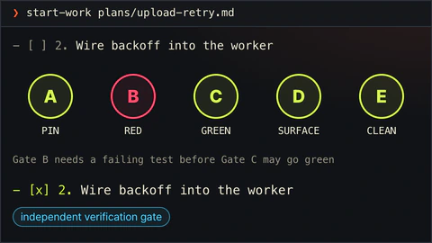</td>
<td><code>start-work</code> <code>start-work &lt;plan&gt;</code></td>
<td>Runs a plan row by row. A box is checked only after all five gates pass.</td>
</tr>
<tr>
<td>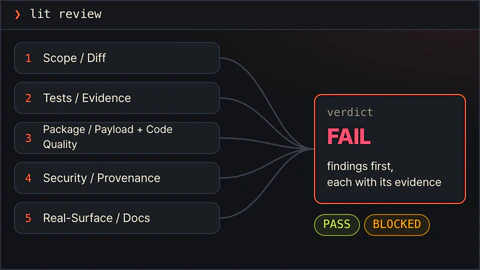</td>
<td><code>review-work</code> <code>lit review &lt;scope&gt;</code></td>
<td>Five independent review lanes read the same change and report findings first.</td>
</tr>
<tr>
<td>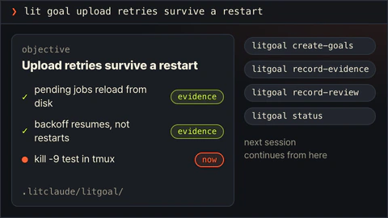</td>
<td><code>litgoal</code> <code>lit goal &lt;outcome&gt;</code></td>
<td>One objective with checkable criteria, kept on disk so the next session can pick it up.</td>
</tr>
<tr>
<td>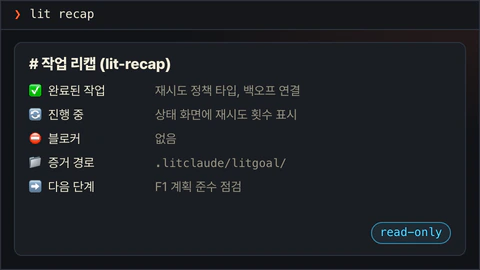</td>
<td><code>lit-recap</code> <code>lit recap</code> · <code>litrecap</code></td>
<td>A read-only summary: done, in progress, blocked, where the evidence is, what comes next.</td>
</tr>
<tr>
<td>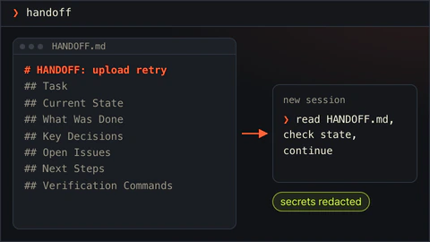</td>
<td><code>lit-handoff</code> <code>handoff</code></td>
<td>Type <code>handoff</code> to get a continuation file the next session can read and resume from.</td>
</tr>
<tr>
<td>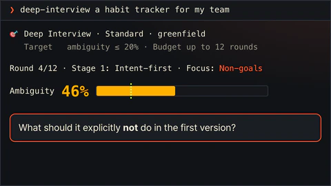</td>
<td><code>deep-interview</code> <code>deep-interview &lt;idea&gt;</code></td>
<td>One question at a time until the idea is clear enough to build. A meter shows how much is still vague.</td>
</tr>
<tr>
<td>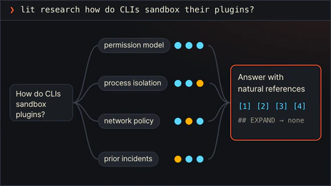</td>
<td><code>litresearch</code> <code>lit research &lt;question&gt;</code> · <code>lit search</code></td>
<td>Splits a research question, sends parallel searchers and follows every lead before answering with sources.</td>
</tr>
<tr>
<td>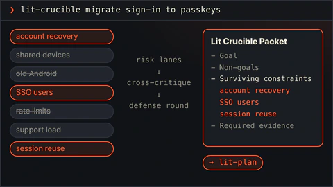</td>
<td><code>lit-crucible</code> <code>lit-crucible &lt;brief&gt;</code></td>
<td>Pressure-tests a brief before planning. Only the risks that survive critique reach the plan.</td>
</tr>
<tr>
<td>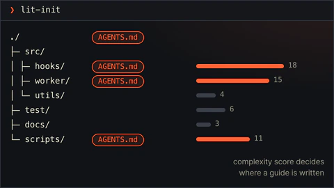</td>
<td><code>lit-init</code> <code>lit-init</code></td>
<td>Maps a repository into a root AGENTS.md and short guides for the folders that need one.</td>
</tr>
<tr>
<td>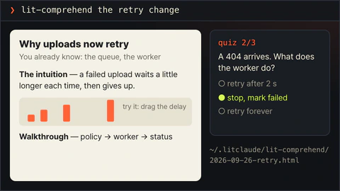</td>
<td><code>lit-comprehend</code> <code>lit-comprehend &lt;target&gt;</code></td>
<td>An explainer page for agent-written work: intuition first, then the walkthrough, then a short quiz.</td>
</tr>
<tr>
<td>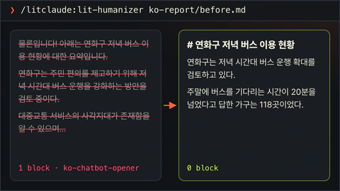</td>
<td><code>lit-humanizer</code> <code>lit-humanizer &lt;text&gt;</code></td>
<td>Rewrites stiff model prose in English or Korean. Facts and hedges stay; filler goes.</td>
</tr>
<tr>
<td>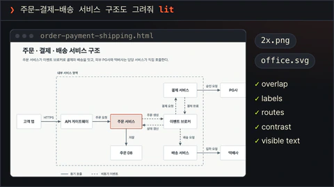</td>
<td><code>lit-diagram-drawer</code> <code>/litclaude:lit-diagram-drawer &lt;brief&gt;</code></td>
<td>A checked, editable diagram for slides and documents, with PNG and Office-safe SVG exports.</td>
</tr>
<tr>
<td>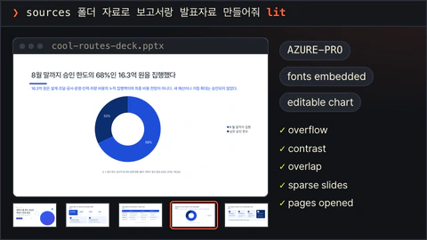</td>
<td><code>lit-pptx</code> <code>/litclaude:lit-pptx &lt;request&gt;</code></td>
<td>Ask for slides with <code>lit</code> and get an editable PowerPoint deck with native charts and embedded fonts. Each slide passes a layout gate and is checked as rendered.</td>
</tr>
<tr>
<td>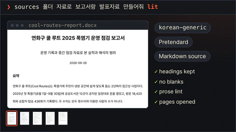</td>
<td><code>lit-docx</code> <code>/litclaude:lit-docx &lt;request&gt;</code></td>
<td>Ask for a report with <code>lit</code> and get a styled Word file with its Markdown source. Korean text is set in Pretendard, and the pages are rendered and read before delivery.</td>
</tr>
<tr>
<td>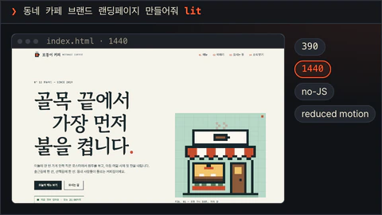</td>
<td><code>frontend-ui-ux</code> <code>frontend-ui-ux build &lt;target&gt;</code></td>
<td>Builds a working interface, then a measured probe renders it in seven views: 320, 390, 768 and 1440 px, dark, reduced motion and 200% zoom.</td>
</tr>
<tr>
<td>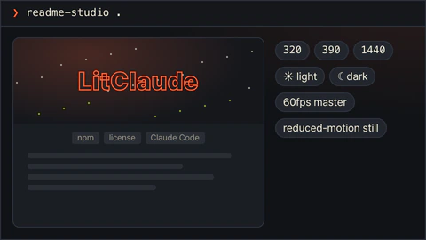</td>
<td><code>readme-studio</code> <code>readme-studio &lt;scope&gt;</code></td>
<td>A factual README with a moving cover, checked at phone and desktop widths in light and dark.</td>
</tr>
<tr>
<td>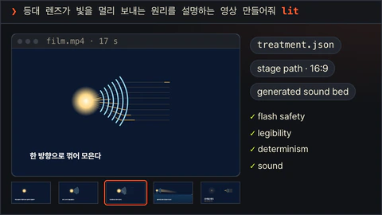</td>
<td><code>lit-typographic-motion</code> <code>/litclaude:lit-typographic-motion &lt;request&gt;</code></td>
<td>Ask for a video with <code>lit</code>. It writes a treatment, draws the scenes or sets the words in motion, adds a sound bed, and checks flashes, legibility and sound before handing over the film.</td>
</tr>
<tr>
<td>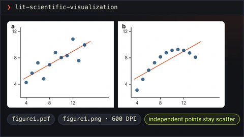</td>
<td><code>lit-scientific-visualization</code> <code>lit-scientific-visualization</code></td>
<td>A journal-sized figure with vector and 600 DPI exports. The chart type follows the data.</td>
</tr>
<tr>
<td>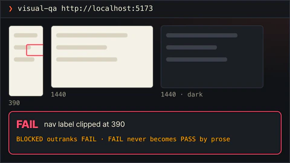</td>
<td><code>visual-qa</code> <code>visual-qa &lt;target&gt;</code></td>
<td>Checks a real screen at each viewport and returns an honest verdict, or names exactly what blocked it.</td>
</tr>
<tr>
<td>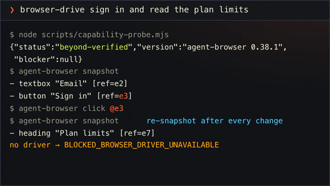</td>
<td><code>browser-drive</code> <code>browser-drive &lt;task&gt;</code></td>
<td>Drives a real page after verifying the browser driver. If there is none, it says so.</td>
</tr>
<tr>
<td>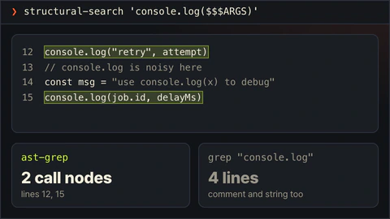</td>
<td><code>structural-search</code> <code>structural-search &lt;pattern&gt;</code></td>
<td>Finds code by its syntax shape, not its text, and previews rewrites before applying them.</td>
</tr>
<tr>
<td>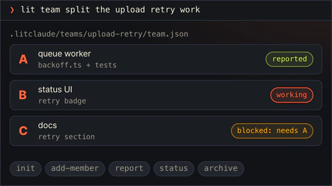</td>
<td><code>lit-team</code> <code>lit team</code> · <code>lit teammates</code></td>
<td>Coordinates several workers with separate slices, each reporting back with evidence.</td>
</tr>
<tr>
<td>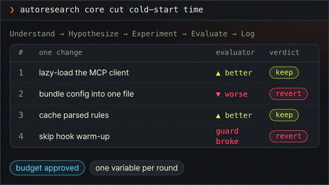</td>
<td><code>autoresearch</code> <code>autoresearch &lt;mode&gt;</code></td>
<td>An approved, budgeted experiment loop. Each round changes one thing and keeps or reverts it.</td>
</tr>
<tr>
<td>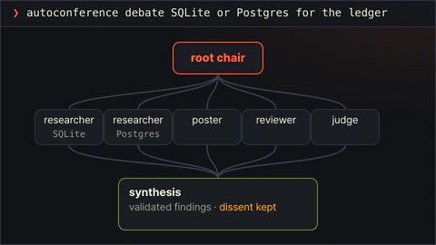</td>
<td><code>autoconference</code> <code>autoconference &lt;mode&gt;</code></td>
<td>A budgeted research conference: separate researchers, reviewers, and a synthesis that keeps disagreement.</td>
</tr>
<tr>
<td>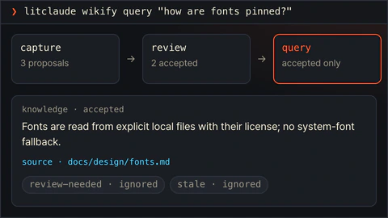</td>
<td><code>wikify</code> <code>litclaude wikify capture|save|review|query|config</code></td>
<td>Keeps reviewed project knowledge on disk and answers later questions from it, with sources.</td>
</tr>
<tr>
<td>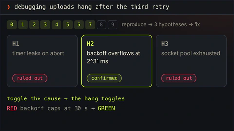</td>
<td><code>debugging</code> <code>debugging &lt;symptom&gt;</code></td>
<td>Reproduces the bug, tests at least three explanations, and fixes only the confirmed cause.</td>
</tr>
<tr>
<td>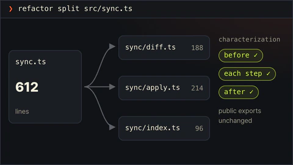</td>
<td><code>refactor</code> <code>refactor &lt;target&gt;</code></td>
<td>Restructures code while tests pin its behavior before and after every step.</td>
</tr>
<tr>
<td>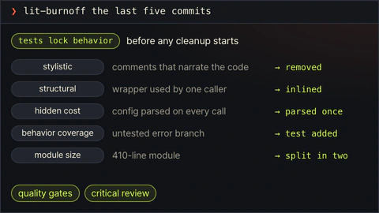</td>
<td><code>lit-burnoff</code> <code>lit-burnoff &lt;scope&gt;</code></td>
<td>Cleans AI-written bloat out of a change set after tests lock what it does.</td>
</tr>
<tr>
<td>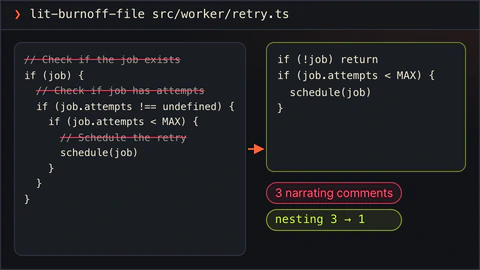</td>
<td><code>lit-burnoff-file</code> <code>lit-burnoff-file &lt;path&gt;</code></td>
<td>The same cleanup for one file: fewer narrating comments, less defensive noise, flatter code.</td>
</tr>
<tr>
<td>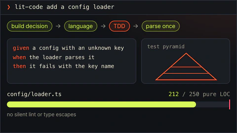</td>
<td><code>lit-code</code> <code>lit-code &lt;task&gt;</code></td>
<td>Strict implementation rules: tests first, typed boundaries, small files.</td>
</tr>
<tr>
<td>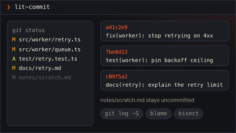</td>
<td><code>lit-commit</code> <code>lit-commit</code></td>
<td>Splits your changes into atomic commits in the repo's own style and leaves unrelated work alone.</td>
</tr>
<tr>
<td>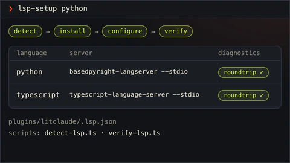</td>
<td><code>lsp-setup</code> <code>lsp-setup &lt;language&gt;</code></td>
<td>Sets up a language server for your language and proves diagnostics really work.</td>
</tr>
<tr>
<td>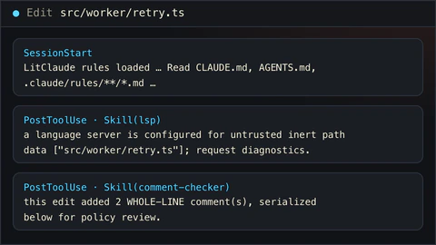</td>
<td><code>rules</code> · <code>lsp</code> · <code>comment-checker</code> runs on its own</td>
<td>Runs on its own: loads your project rules, asks for diagnostics after edits, and reviews new comments.</td>
</tr>
</table>
