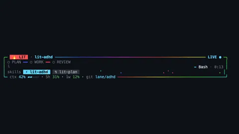
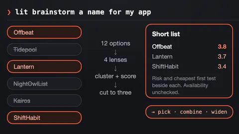
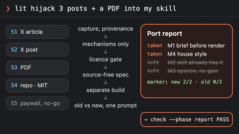
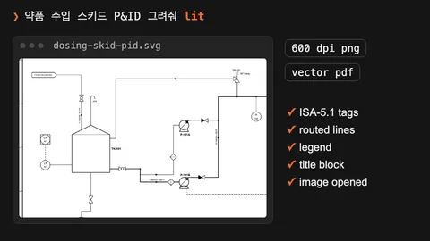

# LitClaude 스킬

[README](../README_ko-KR.md) · [안내서](./guide_ko-KR.md) · [English](./skills.md)

LitClaude에는 직접 시작하는 스킬 39개와 알아서 도는 스킬 3개가 있습니다. 줄마다 스킬이 주는
결과를 그림으로 보여 주고, 시작하는 프롬프트나 명령, 얻는 것을 적었습니다.

## 스킬 한눈에 보기

스킬마다 한 줄입니다. 어떤 모습인지, 어떻게 시작하는지, 무엇을 얻는지 보여줍니다.

<table>
<tr><th>이렇게 됩니다</th><th>스킬</th><th>얻는 것</th></tr>
<tr>
<td></td>
<td><code>lit-loop</code> <code>lit</code></td>
<td>요청 끝에 <code>lit</code>만 붙이세요. 목표를 먼저 고정하고, 실패하는 테스트부터 쓰고, 실제 화면을 확인한 뒤 기록을 남깁니다.</td>
</tr>
<tr>
<td></td>
<td><code>litwork</code> <code>litwork &lt;task&gt;</code></td>
<td>증거와 함께 끝냅니다. 기준마다 실패 테스트부터 정리까지 노트에 남습니다.</td>
</tr>
<tr>
<td></td>
<td><code>lit-plan</code> <code>lit plan &lt;what&gt;</code></td>
<td><code>start-work</code>가 그대로 실행할 수 있는 번호 붙은 작업 목록이 파일로 나옵니다. 코드는 아직 건드리지 않습니다.</td>
</tr>
<tr>
<td></td>
<td><code>start-work</code> <code>start-work &lt;plan&gt;</code></td>
<td>계획을 한 줄씩 실행합니다. 다섯 관문을 모두 통과해야 체크 표시가 붙습니다.</td>
</tr>
<tr>
<td></td>
<td><code>review-work</code> <code>lit review &lt;scope&gt;</code></td>
<td>계획 검토는 일을 시작하기 전에 계획을 살피고, 작업 검토는 끝난 변경을 다섯 갈래로 따로 읽습니다. 발견한 문제부터 보고합니다.</td>
</tr>
<tr>
<td></td>
<td><code>litgoal</code> <code>lit goal &lt;outcome&gt;</code></td>
<td>끝낼 선을 정하고 지킵니다. 목표 하나와 확인 가능한 기준을 디스크에 남기면 <code>lit-loop</code>와 <code>start-work</code>가 그 선을 향해 일합니다.</td>
</tr>
<tr>
<td></td>
<td><code>lit-recap</code> <code>lit recap</code> · <code>litrecap</code></td>
<td>읽기 전용 요약입니다. 끝난 일, 진행 중인 일, 막힌 곳, 증거 위치, 다음 단계를 보여줍니다.</td>
</tr>
<tr>
<td></td>
<td><code>lit-adhd</code> <code>lit adhd</code> · <code>lit-rewind</code></td>
<td>최근 세션 전체를 한 화면에 요약합니다. 세션마다 받은 요청, 한 일, 기다리는 것, 진행 게이지, 다음 한 단계를 보여줍니다.</td>
</tr>
<tr>
<td></td>
<td><code>lit-handoff</code> <code>handoff</code></td>
<td><code>handoff</code>라고 치면 다음 세션이 읽고 이어갈 인수인계 파일이 생깁니다.</td>
</tr>
<tr>
<td></td>
<td><code>lit-brainstorm</code> <code>lit brainstorm &lt;topic&gt;</code></td>
<td>서로 다른 선택지를 많이 내고, 정한 기준으로 점수를 매겨 고를 수 있는 짧은 목록으로 줄입니다. 고른 뒤에는 deep-interview나 lit-plan으로 넘깁니다.</td>
</tr>
<tr>
<td></td>
<td><code>deep-interview</code> <code>deep-interview &lt;idea&gt;</code></td>
<td>한 번에 한 질문씩 물어 아이디어를 만들 수 있을 만큼 분명하게 다듬습니다. 남은 모호함은 게이지로 보입니다.</td>
</tr>
<tr>
<td></td>
<td><code>litresearch</code> <code>lit research &lt;question&gt;</code> · <code>lit search</code></td>
<td>조사 질문을 잘게 나누고 여러 검색을 동시에 돌려, 단서를 끝까지 따라간 뒤 출처와 함께 답합니다.</td>
</tr>
<tr>
<td></td>
<td><code>lit-hijack</code> <code>lit hijack &lt;sources&gt;</code></td>
<td>다른 사람의 글, 저장소, PDF에서 기법을 가져와 내 스킬에 옮깁니다. 출처를 기록하고 라이선스를 확인하며, 원문 없이 쓴 명세로 만들고 전후를 비교해 증명합니다.</td>
</tr>
<tr>
<td></td>
<td><code>lit-crucible</code> <code>lit-crucible &lt;brief&gt;</code></td>
<td>계획 전에 요구사항을 반박해 봅니다. 반박을 견딘 위험만 계획으로 넘어갑니다.</td>
</tr>
<tr>
<td></td>
<td><code>lit-init</code> <code>lit-init</code></td>
<td>저장소를 훑어 루트 AGENTS.md와, 필요한 폴더에만 짧은 안내서를 만듭니다.</td>
</tr>
<tr>
<td></td>
<td><code>lit-comprehend</code> <code>lit-comprehend &lt;target&gt;</code></td>
<td>에이전트가 쓴 작업을 이해하도록 돕는 설명 페이지입니다. 직관, 흐름 설명, 짧은 퀴즈 순서입니다.</td>
</tr>
<tr>
<td></td>
<td><code>lit-humanizer</code> <code>lit-humanizer &lt;text&gt;</code></td>
<td>딱딱한 AI 문장을 한국어나 영어로 다시 씁니다. 사실과 단서는 남기고 군더더기는 뺍니다.</td>
</tr>
<tr>
<td></td>
<td><code>lit-diagram-drawer</code> <code>/litclaude:lit-diagram-drawer &lt;brief&gt;</code></td>
<td>슬라이드와 문서에 넣을 다이어그램을 편집 가능한 형태로 그리고, 검사한 뒤 PNG와 SVG로 내보냅니다.</td>
</tr>
<tr>
<td></td>
<td><code>lit-schematic</code> <code>/litclaude:lit-schematic &lt;brief&gt;</code></td>
<td>실제 장비의 P&amp;ID, 실험 장치 그림, 아이소메트릭 컷어웨이를 그리고, QA 게이트로 검사한 뒤 SVG, PDF, 600 dpi PNG로 내보냅니다.</td>
</tr>
<tr>
<td></td>
<td><code>lit-pptx</code> <code>/litclaude:lit-pptx &lt;request&gt;</code></td>
<td><code>lit</code>으로 발표자료를 요청하면 원본 차트와 글꼴이 들어간 편집 가능한 PowerPoint 파일이 나옵니다. 슬라이드마다 배치 검사를 통과하고, 렌더링된 화면으로 다시 확인합니다.</td>
</tr>
<tr>
<td></td>
<td><code>lit-docx</code> <code>/litclaude:lit-docx &lt;request&gt;</code></td>
<td><code>lit</code>으로 보고서를 요청하면 서식을 갖춘 Word 파일과 원고 Markdown이 나옵니다. 한국어는 Pretendard로 조판하고, 페이지를 렌더링해 읽어 본 뒤 넘깁니다.</td>
</tr>
<tr>
<td></td>
<td><code>frontend-ui-ux</code> <code>frontend-ui-ux build &lt;target&gt;</code></td>
<td>실제로 동작하는 화면을 만들고, 측정 프로브로 일곱 가지 보기를 렌더링합니다. 320·390·768·1440px, 다크 모드, 모션 줄이기, 200% 확대입니다.</td>
</tr>
<tr>
<td></td>
<td><code>readme-studio</code> <code>readme-studio &lt;scope&gt;</code></td>
<td>사실에 맞는 README와 움직이는 커버를 만들고, 휴대폰과 데스크톱 폭, 라이트와 다크 모드에서 확인합니다.</td>
</tr>
<tr>
<td></td>
<td><code>lit-typographic-motion</code> <code>/litclaude:lit-typographic-motion &lt;request&gt;</code></td>
<td><code>lit</code>으로 영상을 요청하면 정해진 규칙으로 네 가지 하우스 스타일 중 하나를 고르고, 전체 렌더 전에 스토리보드부터 보여 줍니다. 장면을 그리거나 글자를 움직이고 사운드를 입힌 뒤, 깜빡임, 가독성, 레이아웃, 소리를 검사하고 영상을 넘깁니다.</td>
</tr>
<tr>
<td></td>
<td><code>lit-scientific-visualization</code> <code>lit-scientific-visualization</code></td>
<td>학술지 규격 그림을 벡터와 600 DPI로 내보냅니다. 그래프 종류는 데이터 성격에 맞춰 고릅니다.</td>
</tr>
<tr>
<td></td>
<td><code>visual-qa</code> <code>visual-qa &lt;target&gt;</code></td>
<td>실제 화면을 폭별로 확인해 결과를 정직하게 돌려줍니다. 막히면 무엇이 막았는지 정확히 알려줍니다.</td>
</tr>
<tr>
<td></td>
<td><code>browser-drive</code> <code>browser-drive &lt;task&gt;</code></td>
<td>브라우저 드라이버를 먼저 확인한 뒤 실제 페이지를 조작합니다. 드라이버가 없으면 그렇다고 말합니다.</td>
</tr>
<tr>
<td></td>
<td><code>structural-search</code> <code>structural-search &lt;pattern&gt;</code></td>
<td>글자 대신 문법 구조로 코드를 찾고, 바꾸기 전에 결과를 미리 보여줍니다.</td>
</tr>
<tr>
<td></td>
<td><code>lit-team</code> <code>lit team</code> · <code>lit teammates</code></td>
<td>여러 작업자에게 겹치지 않는 몫을 나누고, 각자 증거와 함께 보고하게 합니다.</td>
</tr>
<tr>
<td></td>
<td><code>autoresearch</code> <code>autoresearch &lt;mode&gt;</code></td>
<td>승인된 예산 안에서 실험을 반복합니다. 한 번에 하나만 바꾸고, 결과에 따라 남기거나 되돌립니다.</td>
</tr>
<tr>
<td></td>
<td><code>autoconference</code> <code>autoconference &lt;mode&gt;</code></td>
<td>예산을 정한 연구 회의입니다. 연구자와 리뷰어가 따로 일하고, 종합에는 반대 의견도 남깁니다.</td>
</tr>
<tr>
<td></td>
<td><code>wikify</code> <code>litclaude wikify capture|save|review|query|config</code></td>
<td>검토를 거친 프로젝트 지식을 디스크에 두고, 나중 질문에 출처와 함께 답합니다.</td>
</tr>
<tr>
<td></td>
<td><code>debugging</code> <code>debugging &lt;symptom&gt;</code></td>
<td>버그를 재현하고, 가설을 세 개 이상 세워 확인한 뒤, 확인된 원인만 고칩니다.</td>
</tr>
<tr>
<td></td>
<td><code>refactor</code> <code>refactor &lt;target&gt;</code></td>
<td>동작을 테스트로 고정한 채 코드 구조를 바꿉니다. 단계마다 확인합니다.</td>
</tr>
<tr>
<td></td>
<td><code>lit-burnoff</code> <code>lit-burnoff &lt;scope&gt;</code></td>
<td>테스트로 동작을 먼저 묶어 두고, 변경분에 붙은 AI식 군더더기를 걷어냅니다.</td>
</tr>
<tr>
<td></td>
<td><code>lit-burnoff-file</code> <code>lit-burnoff-file &lt;path&gt;</code></td>
<td>파일 하나만 정리합니다. 설명조 주석과 과한 방어 코드를 줄이고 중첩을 펴줍니다.</td>
</tr>
<tr>
<td></td>
<td><code>lit-code</code> <code>lit-code &lt;task&gt;</code></td>
<td>엄격한 구현 규칙입니다. 테스트 먼저, 경계에서 타입 확인, 작은 파일.</td>
</tr>
<tr>
<td></td>
<td><code>lit-commit</code> <code>lit-commit</code></td>
<td>변경을 저장소 스타일에 맞는 작은 커밋으로 나눕니다. 관계없는 작업은 건드리지 않습니다.</td>
</tr>
<tr>
<td></td>
<td><code>lsp-setup</code> <code>lsp-setup &lt;language&gt;</code></td>
<td>사용하는 언어의 언어 서버를 설치하고, 진단이 실제로 도는지 확인합니다.</td>
</tr>
<tr>
<td></td>
<td><code>rules</code> · <code>lsp</code> · <code>comment-checker</code> 자동 실행</td>
<td>알아서 돌아갑니다. 프로젝트 규칙을 읽고, 수정 뒤에는 진단을 요청하고 새 주석을 검토합니다.</td>
</tr>
</table>
